<p align="center">
  <a href="https://cot.kevinliu.studio">
    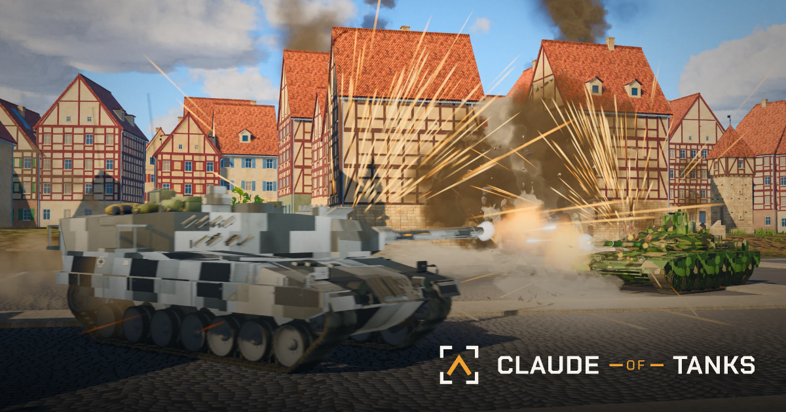
  </a>
</p>

<h1 align="center">CLAUDE OF TANKS</h1>

<p align="center">
<!-- product-summary:start -->
A World of Tanks-style armored combat simulator built directly with Three.js and Vite: 239 vehicles, 33 destructible battlefields, and 13 modes, with plate-level armor, ballistics, modules, spotting, and physics. Play in your browser on desktop or mobile. Built end-to-end by a multi-agent Claude/Codex pipeline.
<!-- product-summary:end -->
</p>

<table width="100%" align="center">
<tr>
<td width="20%" align="center" valign="middle" bgcolor="#05080b"><a href="https://cot.kevinliu.studio/"><br><strong>PLAY</strong></a></td>
<td width="20%" align="center" valign="middle" bgcolor="#05080b"><a href="https://cot.kevinliu.studio/docs"><br><strong>FIELD MANUAL</strong></a></td>
<td width="20%" align="center" valign="middle" bgcolor="#05080b"><a href="https://cot.kevinliu.studio/gallery"><br><strong>TANK GALLERY</strong></a></td>
<td width="20%" align="center" valign="middle" bgcolor="#05080b"><a href="https://cot.kevinliu.studio/studio"><br><strong>SCENE STUDIO</strong></a></td>
<td width="20%" align="center" valign="middle" bgcolor="#05080b"><a href="docs/INDEX.md"><br><strong>ENGINEERING DOCS</strong></a></td>
</tr>
</table>

<table>
<tr>
<td width="50%">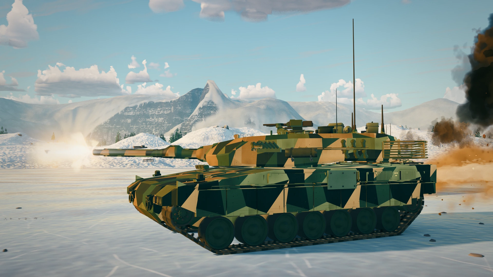</td>
<td width="50%">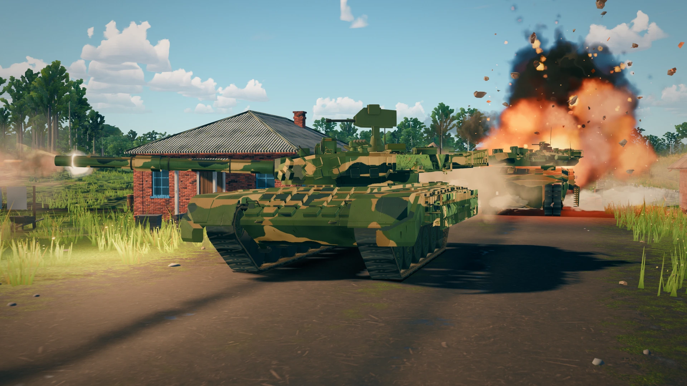</td>
</tr>
<tr>
<td width="50%">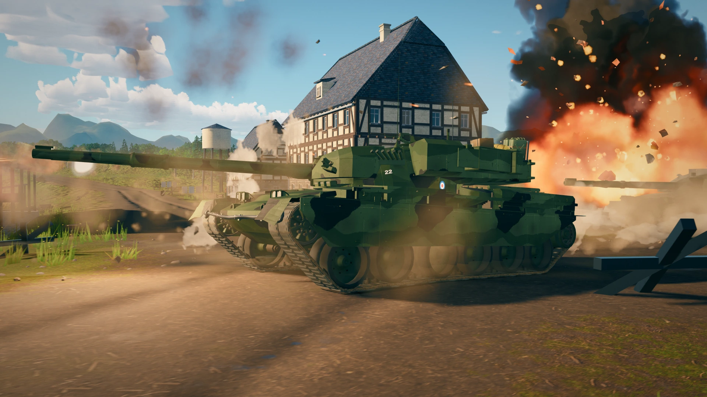</td>
<td width="50%">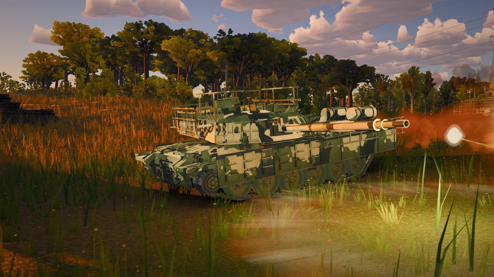</td>
</tr>
</table>

These are deterministic scenes staged in Scene Studio and rendered at 4K in the game engine—not concept art. The
[visual archive](public/media/site50-r14/archive.json) holds the fifty frames and the key moment and close portrait of each of
the site's takes. The [landing selection](public/media/landing-r1/manifest.json) records the 12 hero frames, the 22
screenshots of the rail, the feature reel, the four camera-path loops, the destruction loop, the 21 versus stills, the
3 trailers, the 24-shot mosaic and the Scene Studio loop published on the site.

## Fight, inspect, and direct

<p>
  
  
  
</p>

- **Fight:** enter Standard Battle, Capture the Flag, Zone Control, armed low-gravity Turbo Ball, Gravity Mode, cooperative
  Endless Horde, the six-operation Frontline Assault campaign, Juggernaut, Infected, Realistic, Gun Game, Drone, or AC-130 in solo or multiplayer, with physical shell travel, armor geometry, component damage, spotting,
  terrain, collision, destructible structures, persistent wrecks, mode-specific respawns, and authority-owned results.
- **Watch:** start a watched battle in any of twelve modes on any map: fly a spectator drone over it, ride along in any
  tank, or take a living bot's seat and fight from there.
- **Inspect:** open any vehicle in Tank Gallery, articulate the live rig, isolate armor or internal anatomy, and export an
  exact-surface review packet from the same specification used in combat.
- **Direct:** stage any roster vehicle on any battlefield in Scene Studio, animate actors and cameras, schedule game FX,
  and capture stills or video from reproducible scene data.

## Current release

| | Current runtime |
| --- | --- |
| Fleet | **222** first-party procedural vehicles in production and local development; **0** GLB-sourced playables |
| Worlds | **33** authored battlefields with shared structures, wrecks, utility networks, loose props, placement, collision, and destruction |
| Authority | Fixed **60 Hz** movement, ballistics, armor, damage, spotting, bots, destructibles, and result |
| Presentation | Direct Three.js/WebGL renderer with a measured **120 FPS** test path, adaptive quality, stable shadows, SMAA/FSR, and GPU recovery |
| Play | **13 battle modes**, solo bots, Watch mode (drone, ride-along, take control), browser-hosted private rooms, LAN rooms, room chat, spectators, respawns, and rematches |
| Platforms | Mouse/keyboard and complete touch controls with safe-area layout and device-adaptive rendering |
| Languages | English and Simplified Chinese across the game, Garage, Studio, Gallery, and public docs; local reviewed catalogs managed with General Translation |
| Tools | Scene Studio, Tank Gallery, exact-surface review, deterministic capture, vehicle anatomy, and release gates |

Language selection lives under **Settings → Language → Language**. See the
[localization guide](docs/LOCALIZATION.md) for coverage, intentional exclusions,
the General Translation workflow, and release gates.

The provenance gate currently reports **236 first-party procedural battle playables and 0 GLB-sourced playables**. Comparison inputs are never a playable loading path and are stripped from public builds.

## Field footage

<p>
  
  
</p>

Each frame below opens a looping WebM recorded from the game. The camera rails use live vehicles, maps, ballistics,
recoil, impacts, sparks, smoke, debris, and destruction effects.

<table>
<tr>
<td width="50%"><a href="public/media/site50-r14/loops/s05-barn-advance.webm">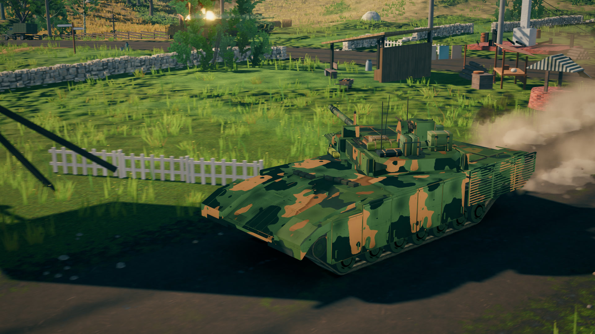</a><br><sub><b>T-14 Armata past the barns:</b> A T-14 Armata advances past the barns of Verdant Fields.</sub></td>
<td width="50%"><a href="public/media/site50-r14/loops/s07-lake-shellfire.webm">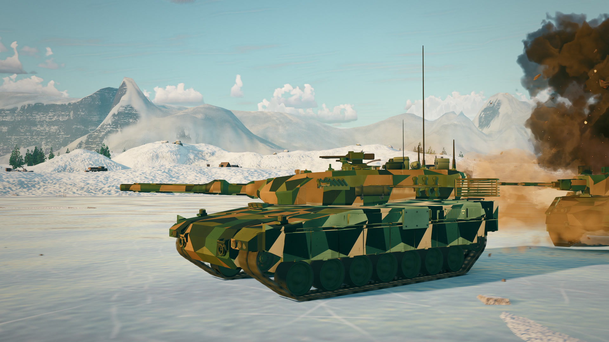</a><br><sub><b>Strv 122 on the frozen lake:</b> A Stridsvagn 122 crosses the frozen lake through shellfire.</sub></td>
</tr>
<tr>
<td width="50%"><a href="public/media/site50-r14/loops/s18-street-knockout.webm">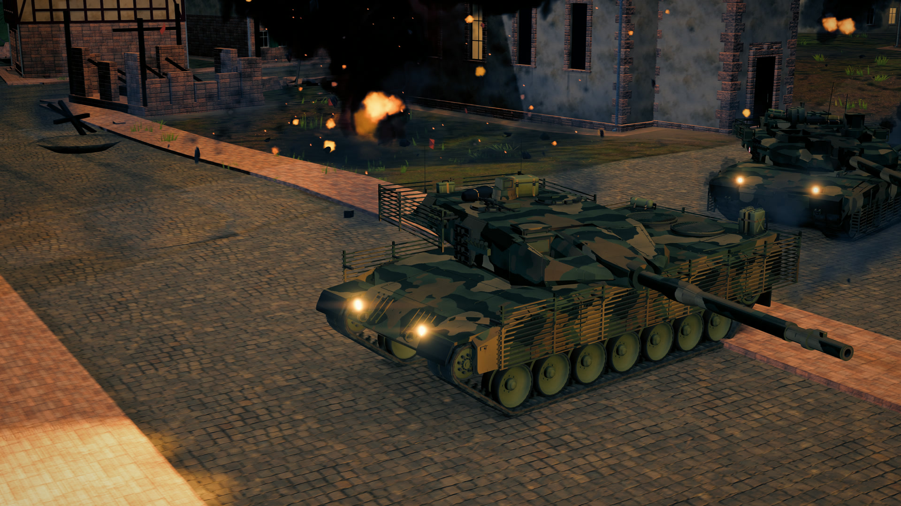</a><br><sub><b>T-90A knocked out at night:</b> A T-90A is knocked out at the end of a Steinburg street at night.</sub></td>
<td width="50%"><a href="public/media/site50-r14/loops/s26-minaret-fire.webm">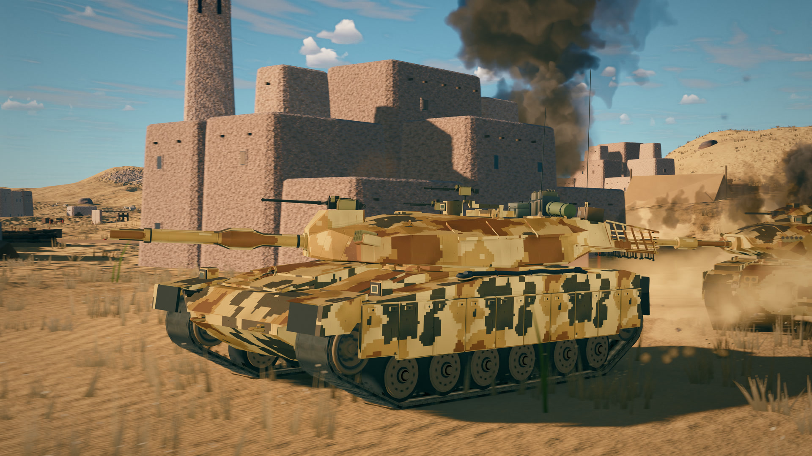</a><br><sub><b>Merkava Mk 3D fires:</b> A Merkava Mk 3D fires at Sunscar Oasis.</sub></td>
</tr>
</table>

<p align="center">
  <a href="https://cot.kevinliu.studio/home"><strong>OPEN THE FULL LANDING SHOWCASE</strong></a>
</p>

## Vehicle-specific mechanics

<p>
  
  
  
</p>

The fleet does not reduce every vehicle to the same gun and movement model. Specifications can add their own loading,
guidance, suspension, ammunition, anatomy, and control behavior while remaining inside the fixed-step authority.

<table>
<tr>
<td width="50%">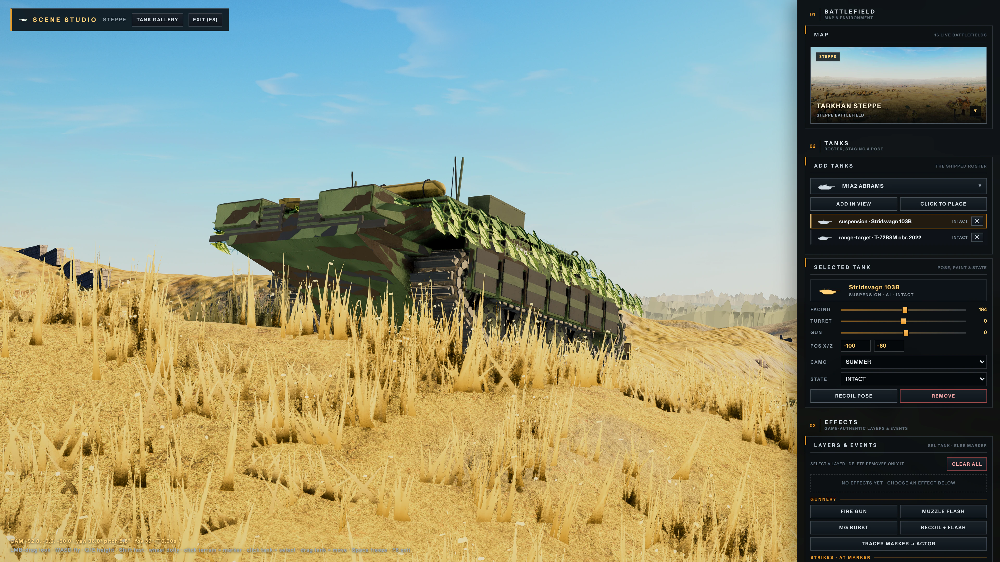<br><sub><b>Swedish siege suspension:</b> the Strv 103A, Strv 103B, and UDES 03 aim their fixed guns by pitching the physical hull. Wheels and both loaded track runs reshape around the solved pose.</sub></td>
<td width="50%">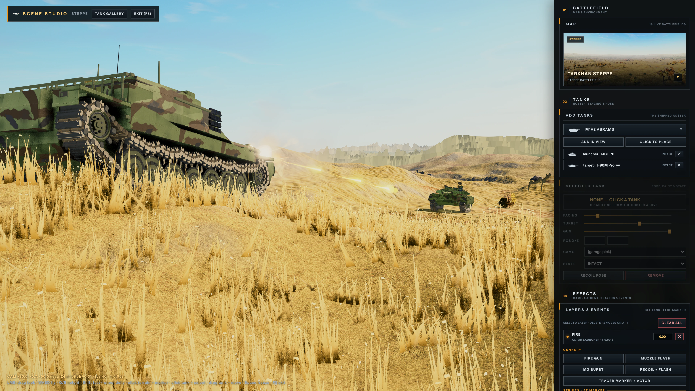<br><sub><b>Guided weapons:</b> the MBT-70 fires the Shillelagh as its primary round. IFVs carry vehicle-specific TOW, MILAN, Spike, Konkurs, Arkan, and Jyu-MAT launchers.</sub></td>
</tr>
<tr>
<td width="50%">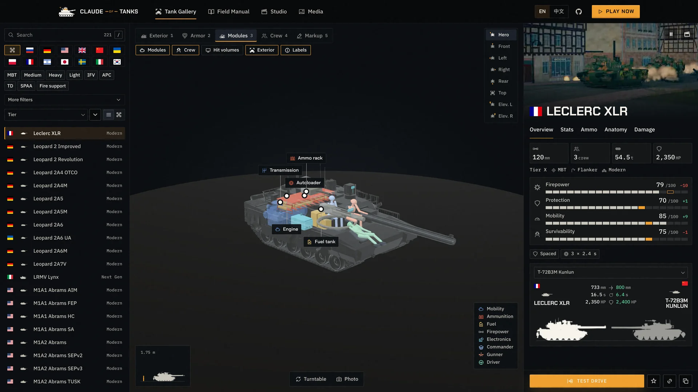<br><sub><b>Internal anatomy:</b> the Gallery shows crew, gun, turret ring, engine, fuel, ammunition, tracks, optics, radio, and vehicle-specific feed or missile systems.</sub></td>
<td width="50%">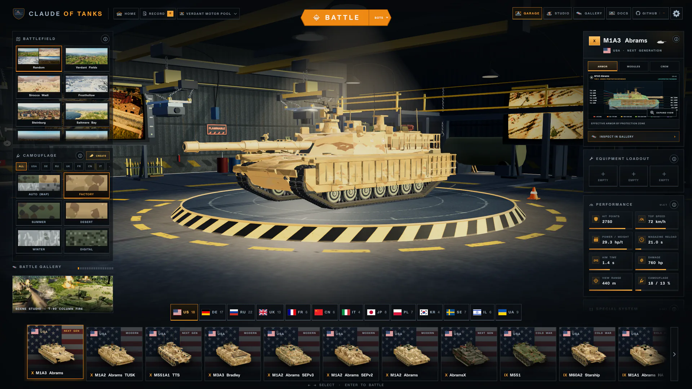<br><sub><b>One shared fleet:</b> battle, garage, Gallery, Studio, bots, icons, diagrams, and technical dossiers read the same vehicle specifications—220 in production and local development.</sub></td>
</tr>
</table>

- **Magazine autoloaders** track ready rounds, intra-magazine cycle time, full replenishment, manual magazine reloads,
  shell changes, and damage to the loading mechanism. The Leclerc, Type 90, PL-01, and four-round PL-01 105 each carry
  their own magazine timings.
- **Guided missiles** travel at visible weapon-specific speeds and steer toward the authority-owned aim point. Launcher
  damage, rack damage, ammunition count, reload state, guidance, impact, and presentation all remain synchronized.
- **Hydropneumatic aim** uses the same canonical pose for armor, muzzle, collision, wheels, tracks, remote snapshots, and
  the camera; there is no separate visual-only tank tilt.
- **Free look** keeps the sight and turret on target while the camera moves. Hold `Shift` on keyboard, `RB` on a standard
  controller, or assign another binding in settings.

## Combat systems

<p>
  
  
  
</p>

<table>
<tr>
<td width="50%">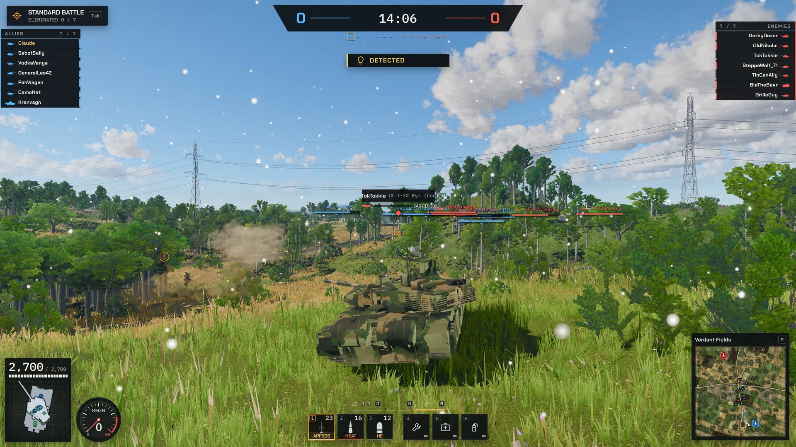<br><sub><b>Battle HUD:</b> dual reticle, ammunition, modules, teams, minimap, chat, performance, and authority-owned combat feedback.</sub></td>
<td width="50%">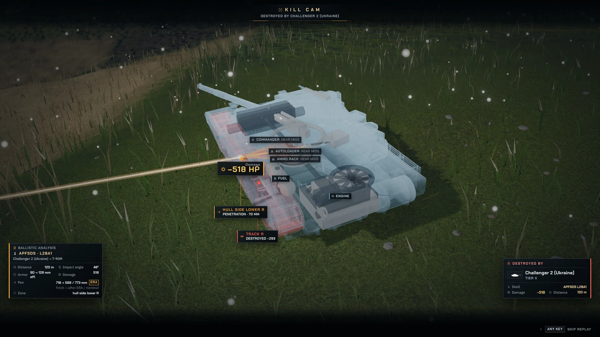<br><sub><b>X-ray killcam:</b> the resolved shell path, struck plate, effective protection, penetration result, damaged modules, and crew.</sub></td>
</tr>
<tr>
<td width="50%">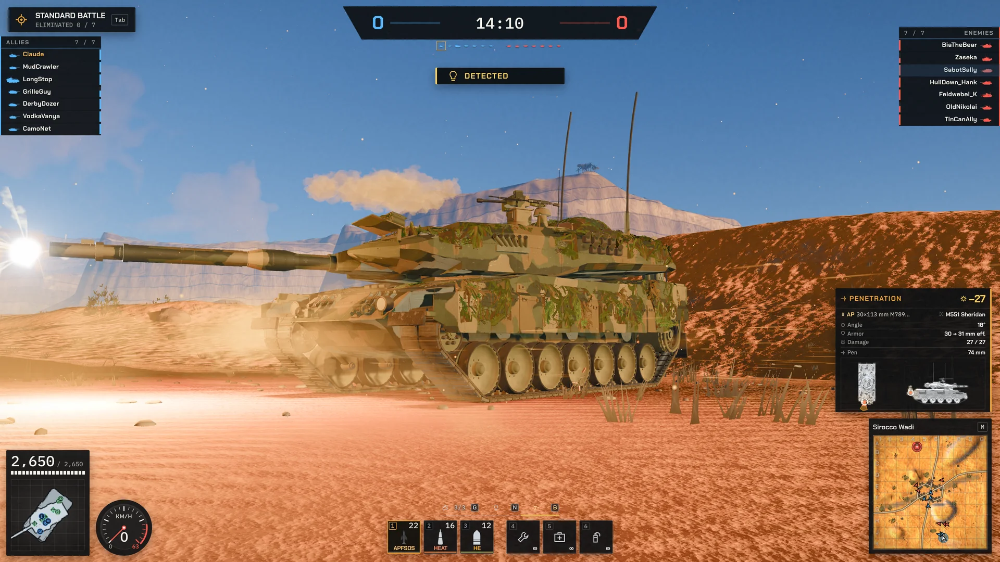<br><sub><b>Physical gunnery:</b> finite world aim, bore convergence, resolved muzzle transform, visible recoil, dispersion, travel time, and gravity.</sub></td>
<td width="50%">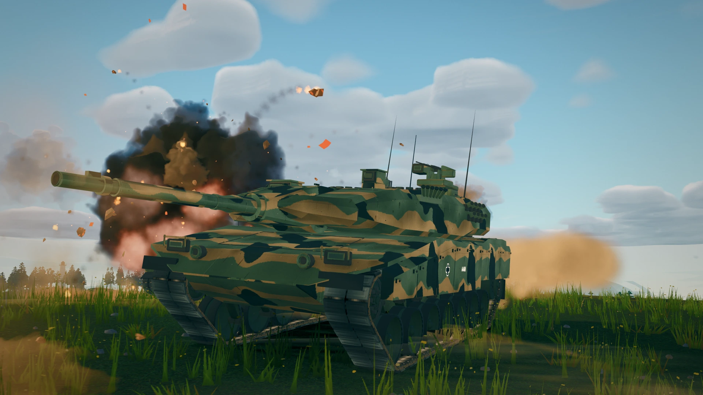<br><sub><b>Destruction:</b> fire, sparks, smoke, detached remnants, persistent wreck state, and pooled effects driven by the completed hit.</sub></td>
</tr>
</table>

- **Plate-level armor** resolves the actual plate, slope, impact angle, normalization, ricochet, overmatch, spaced armor,
  composites, ERA, and separate kinetic/chemical protection.
- **Five ammunition families** model muzzle velocity, gravity, penetration loss, ricochet, and damage differently.
- **Internal anatomy** tracks crew, ammunition racks, engine, fuel, gun, turret ring, optics, radio, and tracks.
- **Tank-specific mobility** combines drivetrain, terrain resistance, per-wheel support, suspension-damped hull attitude,
  flexible terrain-following tracks, collision, ramming, and crushable cover.
- **Real battlefield knowledge** combines view range, concealment, movement/firing bloom, foliage, radio sharing, and the
  15 m bush rule. Multiplayer authority filters hidden enemies before serializing a snapshot.

## Worlds and vehicle design

<p>
  
  
  
</p>

<table>
<tr>
<td width="50%">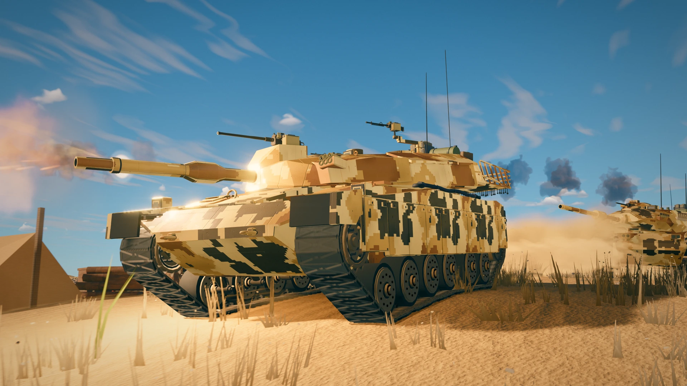<br><sub><b>Thirty worlds:</b> terrain, roads, structures, foliage, fog, sky, lighting, cover, collision, minimap, and dedicated-server descriptors.</sub></td>
<td width="50%">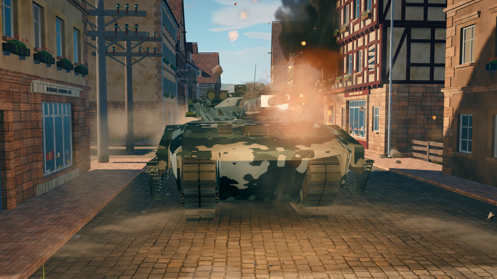<br><sub><b>Shared world kit:</b> destructible buildings, camps, wreck families, debris, utility lines, loose physical props, and narrow hitboxes.</sub></td>
</tr>
<tr>
<td width="50%">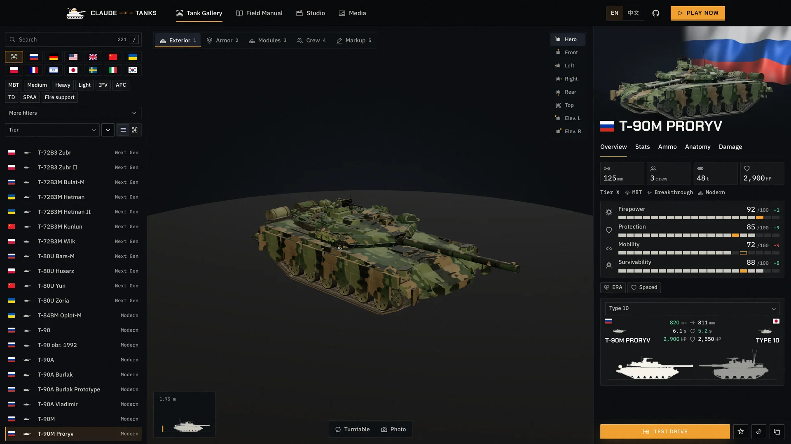<br><sub><b>Tank Gallery:</b> search 222 production vehicles, orbit and articulate the current vehicle rig, inspect armor, modules, and crew, and export exact-surface review packets.</sub></td>
<td width="50%">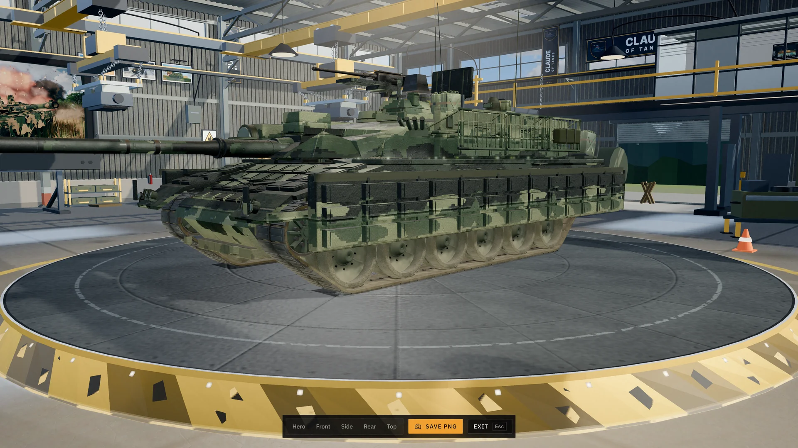<br><sub><b>Shared vehicle specification:</b> geometry, armor, modules, gun limits, ammunition, mobility, garage cards, bots, icons, diagrams, Gallery, and Studio.</sub></td>
</tr>
</table>

Every playable hull, turret, gun, fitting, suspension, road wheel, and track run is assembled by the repository's
first-party vehicle pipeline. Vehicle changes pass combat-anatomy receipts, generated technical diagrams, geometry
checks, visual fingerprints, and a targeted release gate.

### Ten Garage environments

<p align="center">
  <a href="public/media/showcase-r2/process/review-01.webp">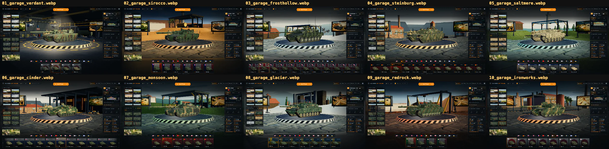</a>
</p>

The Garage is its own authored presentation system. Verdant retains the enclosed Motor Pool; the other nine locations
use lightweight scene packs derived from a real battlefield's terrain, structures, PBR materials, detailed trees,
approach route, horizon, sky, and atmosphere without loading that battlefield. One immutable hero pose keeps the tank
and camera comparable across the complete set, while connected maintenance stations, heavy-lift equipment, real fleet
exhibits, and full-detail tank parts establish a distinct service story around every platform.

The release gate reviews every location from four orbit angles and responsive layouts, rejects unsupported or floating
parts, certifies geometry-derived structure collision, and requires a score of at least 90/100 with bounded draw calls,
triangles, transitions, cache residency, and repeated-cycle memory. See the
[Garage environments guide](docs/GARAGE-ENVIRONMENTS.md) for the complete visual, lifecycle, and verification contract.

## Renderer, drivers, and performance

<p>
  
</p>

The renderer treats quality as a device contract instead of a single desktop preset. It selects a GPU/driver-aware
profile, caps pixel density, prewarms shader paths, adapts costly effects, and can recover from a black frame or WebGL
context loss. The current presentation path combines:

- four quality-scaled, stable texel-anchored shadow cascades with articulation-aware tank shadow hulls;
- fused output grading, anti-aliasing, adaptive render scale, fog/atmosphere, and bounded transparent depth work;
- instance/batch paths for repeated world objects, pooled particles, and explicit GPU resource disposal;
- reusable hot-loop scratch state, fixed-step simulation, render interpolation, and high-refresh presentation;
- an in-game diagnostics surface for FPS, ping, frame timing, draw calls, triangles, memory, network telemetry, quality,
  and renderer/driver identity.

The renderer reached **120 FPS on the certified test hardware**. Actual performance depends on refresh rate, browser,
thermal limits, GPU and driver, resolution, and quality level. Combat rules remain fixed at 60 Hz at every render rate.

<table>
<tr>
<td width="50%">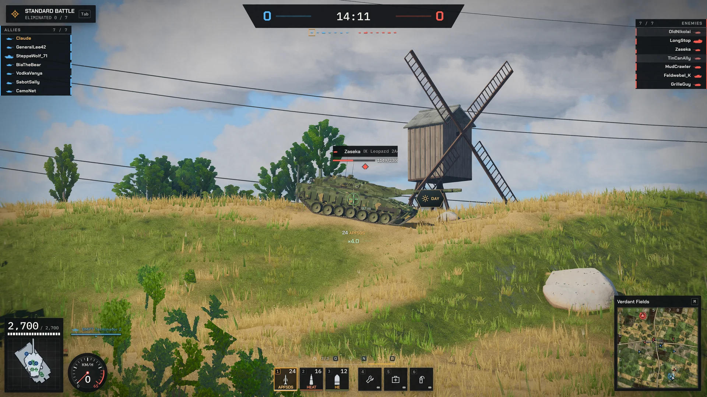<br><sub><b>Presentation:</b> high-resolution scope, stable shadowing, post AA, bounded depth copies, and readable combat overlays.</sub></td>
<td width="50%">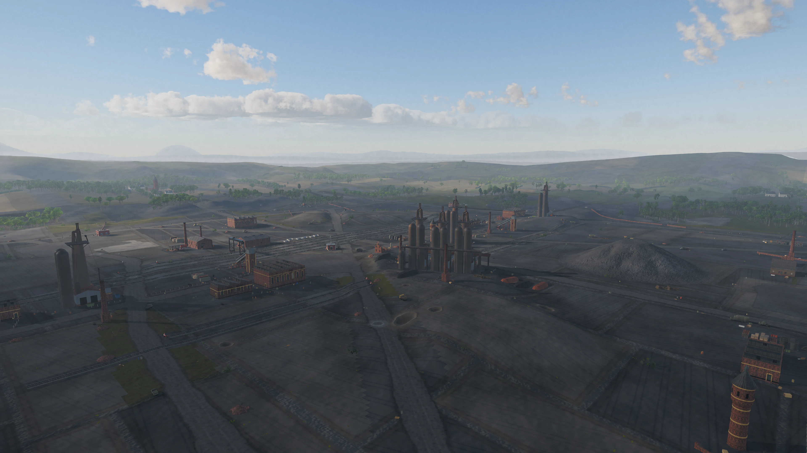<br><sub><b>World rendering:</b> authored layouts and detailed environments use adaptive quality, instancing, culling, and streaming.</sub></td>
</tr>
</table>

## Multiplayer

<p>
  
</p>

LAN and private rooms run their match in the host commander's browser over WebRTC and use the shared renderer-free movement and combat rules. No database or dedicated game server is required; Internet rooms meet through a small rooms Worker (seats, signaling, host migration), and restricted networks may need TURN relay. See [Multiplayer v2](docs/MULTIPLAYER-V2.md).
Clients send intent, never trusted hits or damage. Snapshot filtering, local prediction/reconciliation, bounded remote
interpolation, reliable fire edges, reconnectable room state, and separate control/chat delivery keep a moving and firing
7v7 battle responsive without giving the client authority.

<p align="center">
  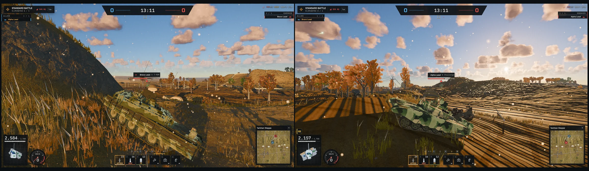
</p>
<p align="center"><sub><b>Two screens, opposing sights:</b> paired live 1v1 captures preserve the real battle HUD, authoritative simulation, filtered snapshots, and each commander's view.</sub></p>

### Controls at a glance

| Action | Keyboard and mouse | Standard controller |
| --- | --- | --- |
| Drive and steer | `WASD` or arrow keys | Left stick |
| Aim and fire | Mouse + `LMB` | Right stick + `RT` |
| Precision sight | Hold `RMB` by default; wheel in also enters | `LT` |
| Free look without moving the turret | Hold `Shift` or `Left Alt` | `RB` |
| Select ammunition | `1` / `2` / `3` | D-pad |
| Vehicle-specific action | `E` | `LB` |
| Reload a partial magazine | `C` | Remappable |
| Consumables | `4` / `5` / `6` | Remappable |
| Handbrake | `Space` | `A` |
| Shot log / battle diagnostics / menu | `L` / `F9` / `Esc` | Interface controls |

Every desktop action is remappable. `RMB` can use hold-to-aim, toggle-aim, or classic free-look behavior. Touch devices
receive dedicated movement, aim, scope, fire, ammunition, equipment, and special-action controls rather than a scaled
desktop HUD.

## Production tools

For procedural vehicle creation, use the [tank-generation handbook](docs/tank-generation/README.md):
source-file and Gallery-markup intake, measured geometry and negative space,
independent review gates, reusable agent briefs, and handoff templates.

<p>
  
  
  
</p>

<table>
<tr>
<td width="50%">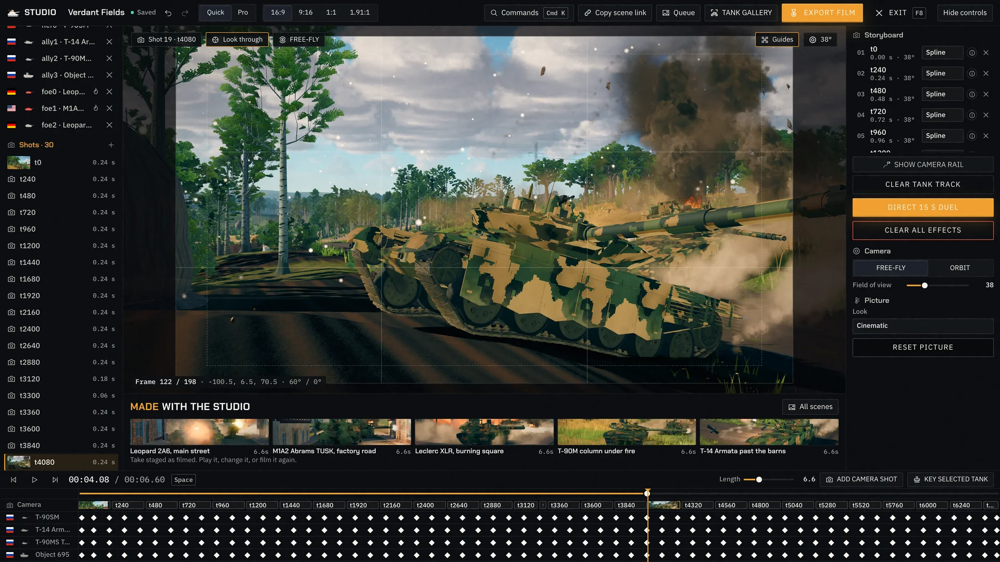<br><sub><b>Scene Studio:</b> place any roster vehicle on any map, conform it to terrain, set its pose within physical limits, schedule game effects on a deterministic timeline, and capture the current renderer.</sub></td>
<td width="50%"><a href="public/media/landing-r1/studio-leclerc-knockout.mp4">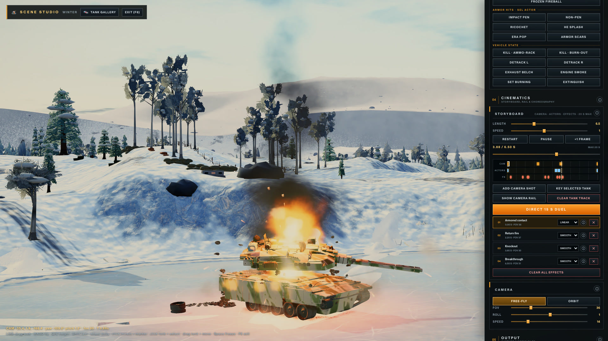</a><br><sub><b>Directed destruction:</b> this 1080p timeline moves both actors, fires the Strv 122, resolves impacts, detaches the Leclerc track, and triggers its ammunition-rack blast.</sub></td>
</tr>
</table>

Scene Studio works with the runtime rather than a separate cinematic renderer. Vehicles, camouflage, camera, lighting,
recoil, tracers, explosions, sparks, smoke, debris, wreck state, and timeline events remain scene data. A saved scene can
be replayed, scrubbed, edited, exported as JSON, captured as a high-resolution still, or recorded as a video.

Regenerate the current public archive:

```bash
npm run shots:battle:generate
npm run shots:battle:grade -- --root shots/marketing-battles-r3
npm run studio:action:render
npm run showcase:publish
npm run showcase:check
npm run landing:media:publish
```

The capture harness serializes concurrent jobs, starts a clean local game, verifies the requested state, and records
current rendering diagnostics. `public/media/site50-r14/archive.json` is the source archive (the fifty frames and every take's two stills);
`public/media/landing-r1/manifest.json` records the public hero, rail, mosaic, and Studio selections with their actor,
effect, duration, dimensions, and byte receipts.

The same run is reviewed in contact sheets before any frame becomes a 4K master. These collection views make weak
silhouettes, obstructed cameras, repeated compositions, and overpowered effects obvious before automated grading.

<table>
<tr>
<td width="50%"><a href="public/media/site50-r14/frames/sheet-1.webp">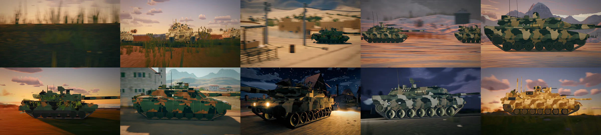</a><br><sub><b>Review sheet 1:</b> ten of the fifty frames, each a 4K render of a moving scene with its motion blur.</sub></td>
<td width="50%"><a href="public/media/site50-r14/frames/sheet-2.webp">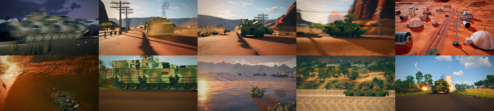</a><br><sub><b>Review sheet 2:</b> the next ten, as the manual shows them beside the battle takes.</sub></td>
</tr>
</table>

The manual shows all five sheets; [docs/SHOWCASE-LIBRARY.md](docs/SHOWCASE-LIBRARY.md) records the library and how it is built.

## Selected field frames

The landing page publishes a larger responsive mosaic. This smaller wall samples the site fifty's key moments and close portraits
without repeating the hero's frames.

<table>
<tr>
<td width="25%">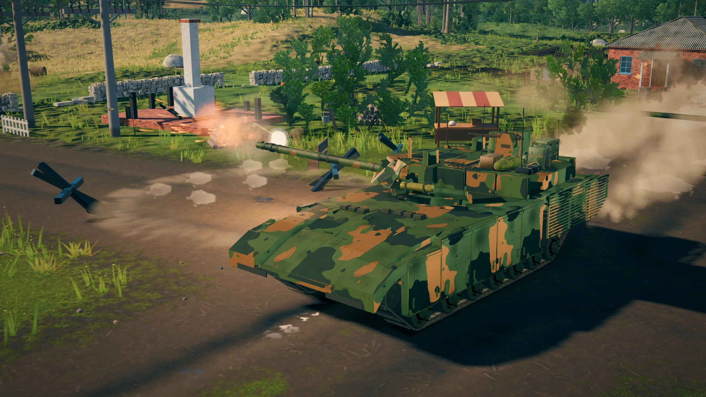</td>
<td width="25%"></td>
<td width="25%">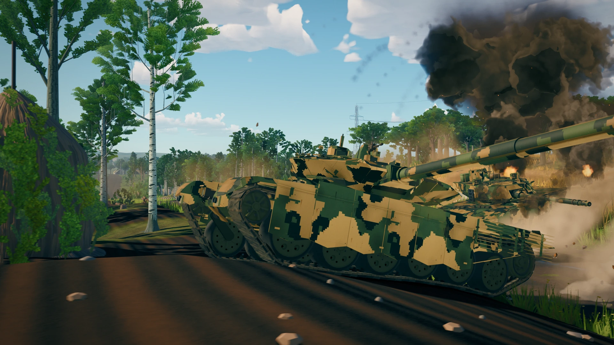</td>
<td width="25%">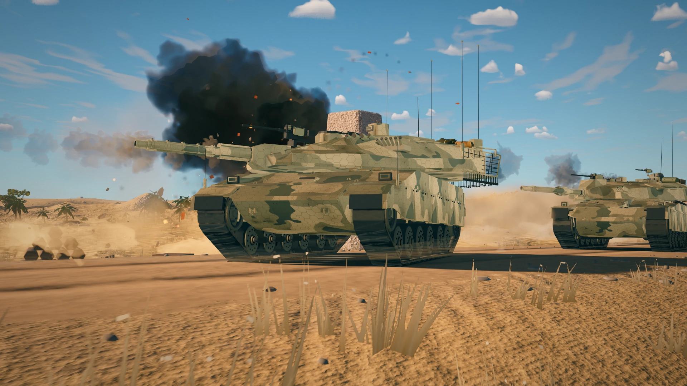</td>
</tr>
<tr>
<td width="25%">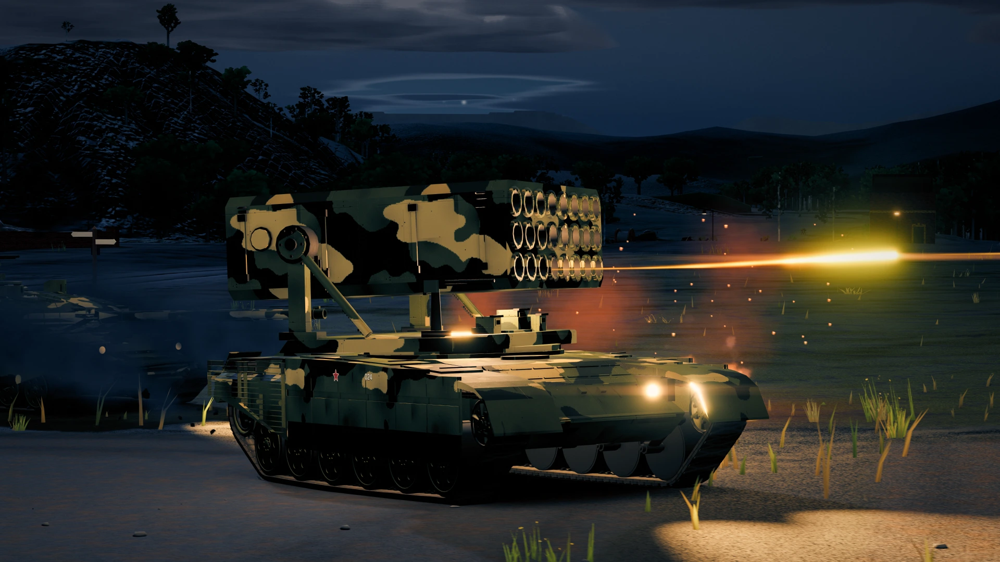</td>
<td width="25%">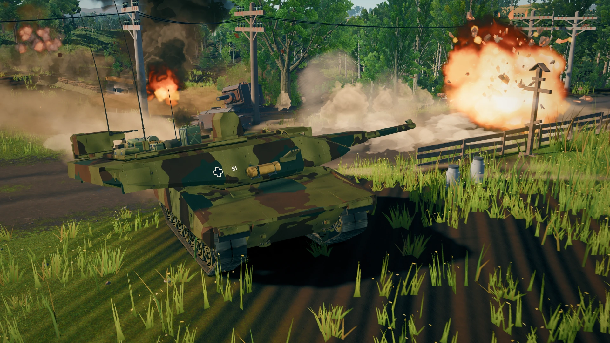</td>
<td width="25%"></td>
<td width="25%">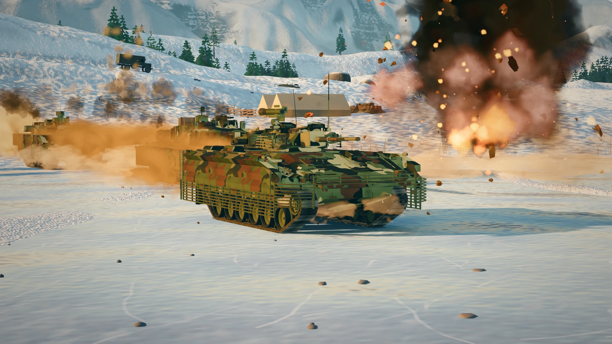</td>
</tr>
<tr>
<td width="25%">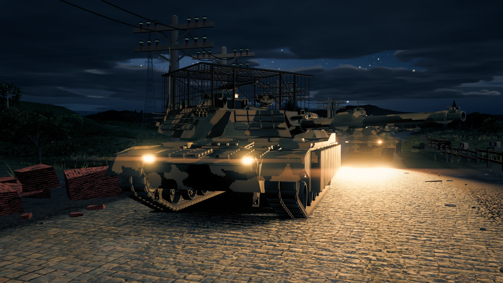</td>
<td width="25%">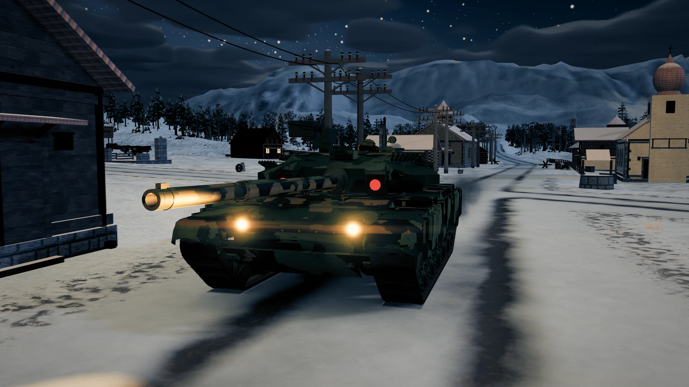</td>
<td width="25%">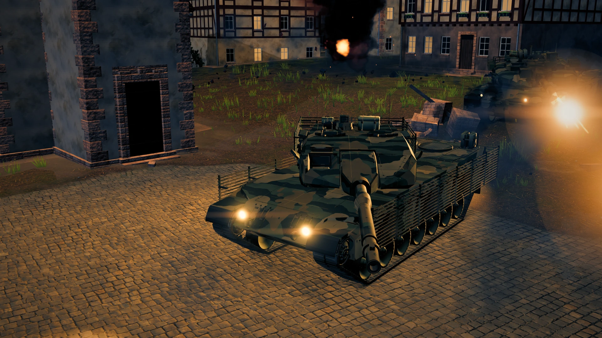</td>
<td width="25%">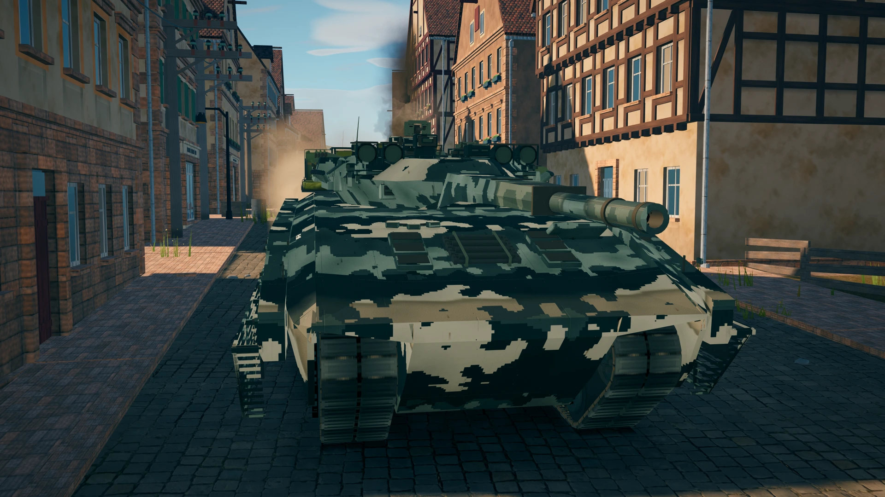</td>
</tr>
</table>

[Browse the full archive](public/media/site50-r14/archive.json),
[open the public Tank Gallery](https://cot.kevinliu.studio/gallery), or
[build a new shot in Scene Studio](https://cot.kevinliu.studio/studio).

## Architecture

```text
controls ──► deterministic authority ──► filtered state + reliable events ──► presentation
                 │                                                           │
                 ├─ movement / terrain / collision                            ├─ procedural vehicles
                 ├─ aim / ballistics / armor / anatomy                        ├─ tracks / suspension / FX
                 ├─ spotting / concealment / bots                             ├─ HUD / audio / killcam
                 └─ destructibles / match result                              └─ Three.js / post / Studio
```

```text
src/engine/    renderer, camera, lighting, post, quality, telemetry, GPU recovery
src/world/     thirty-three maps, terrain, vegetation, props, collision, destruction
src/vehicles/  specs, procedural geometry, materials, profiles, asset verification
src/sim/       DOM-free movement, aiming, ballistics, armor, damage, spotting
src/game/      local composition, bots, input, profile, killcam, Scene Studio
src/mp/        rooms, the wire, transports, the match client, the browser host, sessions
src/ui/        garage, battle HUD, reports, Service Record, settings, the component kit, tokens, type
src/presentation/  the public site's shell, landing, media player and the /cn build
src/docs/      the Field Manual: chapters built from the game's own tables, prerendered
src/gallery/   Tank Gallery
server/        the match actor, the LAN room helper, collision manifests, ICE, telemetry
```

Start with [Technical overview](docs/TECHNICAL-OVERVIEW.md), [Product features](docs/FEATURES.md),
[How it works](docs/HOW-IT-WORKS.md), [Multiplayer v2](docs/MULTIPLAYER-V2.md),
[Performance](docs/PERFORMANCE.md), [Scene Studio](docs/STUDIO.md), and [Tank Gallery](docs/GALLERY.md).

## Develop and verify

```bash
npm install
npx vite
npm test
npm run test:net:v2:p2p
npm run tank:native:check
npm run build
npm run build:private
```

The public pages carry generated parts; after a change to a chapter, the landing,
the shell or the tokens, rewrite them (each checks without `--write`):

```bash
node tools/docs-prerender.mjs --write
node tools/home-premiere.mjs --write
node tools/public-shell.mjs --write
node tools/gen-tokens.mjs
```

The public build strips quarantined comparison assets. Simulation, networking, browser multiplayer, maps, collision,
destruction, rendering policy, UI, mobile controls, vehicle provenance, anatomy, generated assets, and both build variants
have executable checks.

## Deploying

Production (`cot.kevinliu.studio`) is deployed **once per round, by hand**, never per commit. Git
auto-deploys are disabled in `vercel.json` for every branch, so pushing never builds on
Vercel; the release path is the prebuilt CLI deploy documented in [`docs/DEPLOYS.md`](docs/DEPLOYS.md)
(`vercel pull --yes --environment=production` → `vercel build --prod` → `vercel deploy --prebuilt --prod`),
run after the release gate is green. There is no CI deploy.

## Credits and licensing

**Kevin B. Liu** created, designed, and directed the project. Claude and Codex assisted with research, vehicle authoring,
simulation, networking, design, performance, quality assurance, documentation, and deployment. They are development
tools, not co-authors or copyright holders.

All gameplay code and every selectable procedural vehicle model are original first-party work by Kevin B. Liu. The
repository is MIT-licensed by default, with procedural vehicle and battlefield source, fleet and map data, generated game
assets, capture recipes, authored media, and first-party branding expressly excluded as proprietary Reserved Content.
Earlier public revisions remain available under the MIT terms under which they were released. See [`LICENSE`](LICENSE), [`LICENSE-POLICY.md`](LICENSE-POLICY.md),
[`NOTICE.md`](NOTICE.md), and [`docs/ATTRIBUTION.md`](docs/ATTRIBUTION.md) before reusing any file. External models may be
retained only as quarantined research references; they are never loaded as playable geometry.
