<p align="center">
  <a href="https://cot.kevinliu.studio">
    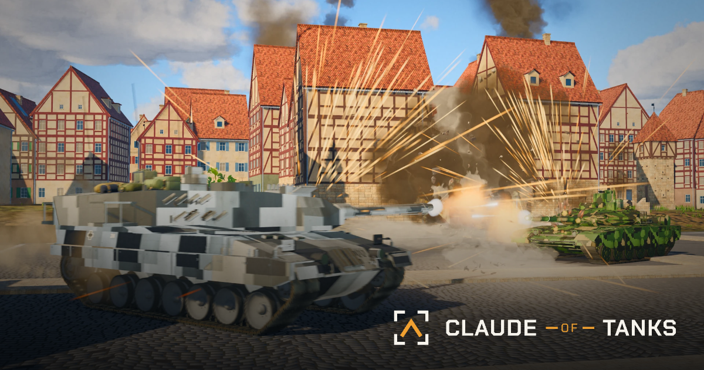
  </a>
</p>

<h1 align="center">CLAUDE OF TANKS</h1>

<p align="center">
<!-- product-summary:start -->
A World of Tanks-style armored combat simulator built directly with Three.js and Vite: 311 vehicles, 33 destructible battlefields, and 14 modes, with plate-level armor, ballistics, modules, spotting, and physics. Play in your browser on desktop or mobile. Built end-to-end by a multi-agent Claude/Codex pipeline.
<!-- product-summary:end -->
</p>

<table width="100%" align="center">
<tr>
<td width="20%" align="center" valign="middle" bgcolor="#05080b"><a href="https://cot.kevinliu.studio/"><br><strong>PLAY</strong></a></td>
<td width="20%" align="center" valign="middle" bgcolor="#05080b"><a href="https://cot.kevinliu.studio/docs"><br><strong>FIELD MANUAL</strong></a></td>
<td width="20%" align="center" valign="middle" bgcolor="#05080b"><a href="https://cot.kevinliu.studio/gallery"><br><strong>TANK GALLERY</strong></a></td>
<td width="20%" align="center" valign="middle" bgcolor="#05080b"><a href="https://cot.kevinliu.studio/studio"><br><strong>SCENE STUDIO</strong></a></td>
<td width="20%" align="center" valign="middle" bgcolor="#05080b"><a href="docs/INDEX.md"><br><strong>ENGINEERING DOCS</strong></a></td>
</tr>
</table>

<table>
<tr>
<td width="50%">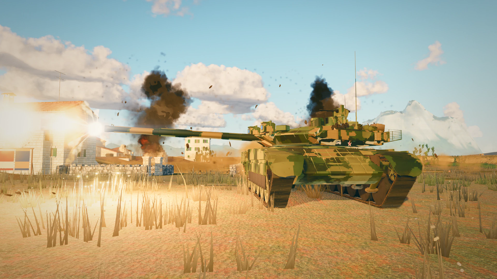</td>
<td width="50%">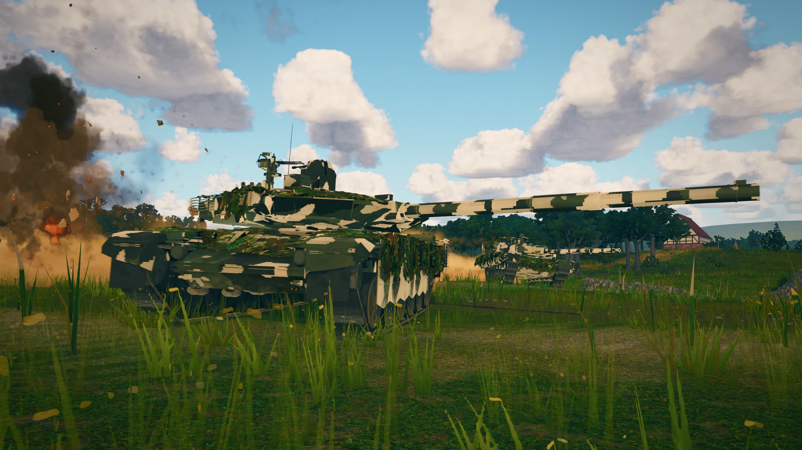</td>
</tr>
<tr>
<td width="50%">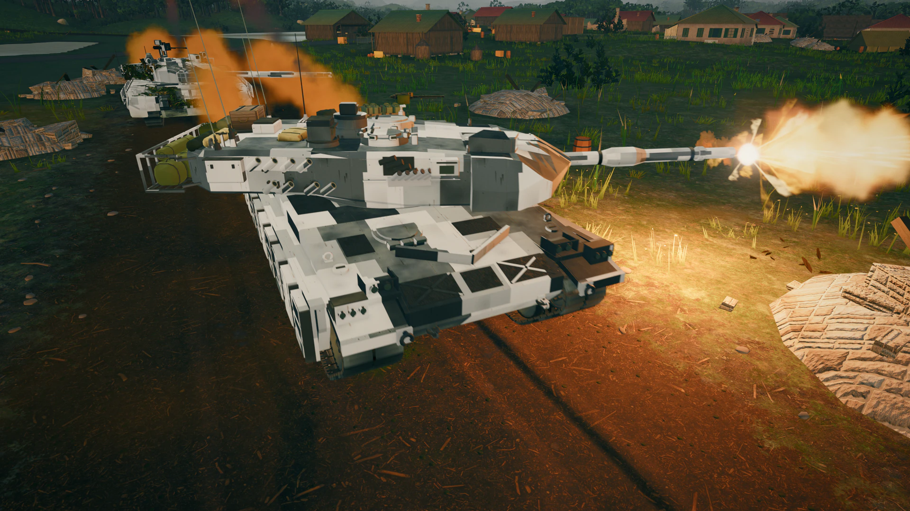</td>
<td width="50%">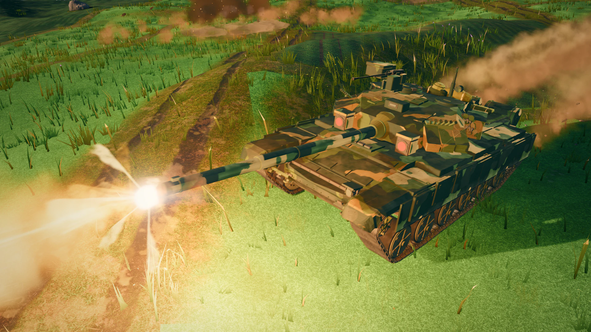</td>
</tr>
</table>

Every picture here is captured in the game engine. The four above come from the
[battle gallery](public/media/gallery-r1/manifest.json) that the Garage and the Field Manual show.

## Fight, watch, inspect, and direct

<p>
  
  
  
</p>

- **Fight:** Standard Battle, Drone, Zone Control, Capture the Flag, Frontline Assault, armed Turbo Ball, low-gravity
  Gravity Mode, cooperative Endless Horde, Gun Game, Juggernaut, Infected, Realistic, AC-130, or Air Support, solo against
  bots or in a room. The six-operation campaign runs on Frontline Assault, and the Proving Ground is a practice range with
  no enemies and no clock. Shells travel, armor has geometry, components break, structures fall, and wrecks stay.
- **Watch:** start a watched battle in any of 13 modes (all but AC-130) on any map. Fly a spectator drone, ride along in
  any tank, or take a living bot's seat and fight from there.
- **Couch:** put a QR code on the big screen and up to eight phones join one local battle, each driving its own tank. The
  lobby opens on one Shared view; Split gives each player a pane and is marked Experimental.
- **Inspect:** open any vehicle in Tank Gallery, articulate the live rig, isolate armor or internal anatomy, and export an
  exact-surface review packet from the same specification used in combat.
- **Direct:** stage any roster vehicle on any battlefield in Scene Studio, animate actors and cameras, schedule game FX,
  and capture stills or video from reproducible scene data.

## Current release

| | Live at [cot.kevinliu.studio](https://cot.kevinliu.studio) |
| --- | --- |
| Fleet | **311** first-party procedural vehicles, every one playable in battle |
| Worlds | **33** authored battlefields with shared structures, wrecks, utility networks, loose props, collision, and destruction |
| Authority | Fixed **60 Hz** movement, ballistics, armor, damage, spotting, bots, destructibles, and result |
| Presentation | Direct Three.js/WebGL renderer with a measured **120 FPS** test path, adaptive quality, stable shadows, SMAA/FSR, and GPU recovery |
| Play | **14 battle modes** and the Proving Ground, solo bots, Watch, couch play on phones, browser-hosted private rooms, LAN rooms, room chat, spectators, respawns, and rematches |
| Platforms | Mouse and keyboard, standard controllers, and full touch controls with safe-area layout and device-adaptive rendering |
| Languages | English and Simplified Chinese across the game, Garage, Studio, Gallery, and public docs; crew radio in 38 voice packs |
| Security | An enforced Content Security Policy that names every inline script on the production pages by hash |
| Tools | Scene Studio, Tank Gallery, exact-surface review, deterministic capture, vehicle anatomy, and release gates |

Language selection lives under **Settings → Language → Language**. The [localization guide](docs/LOCALIZATION.md) covers
coverage, exclusions, the General Translation workflow, and release gates. Every deploy has a row in
[`docs/DEPLOYS.md`](docs/DEPLOYS.md).

### Since 270

- **Twelve new vehicles**, 299 to 311. Seven are air defense: the M163 VADS with its rotary cannon, the Type 87, the
  Marksman, the ItPsv Leopard 2, the Lvkv 9040, the K30 Biho, and the PZA Loara. Five carry 152 mm guns: Object 292,
  Object 477 Molot, Object 195, T-14 152, and T95.
- **Rebuilt vehicles:** the Ariete preseries and prototypes, the BMP-2 and BMP-3, and other Italian, Korean, and
  Chieftain hulls. Object 292 and Molot got new looks. The M6 Linebacker now fights as air defense: a 1,200-round-a-minute
  chain gun and 36 Stingers fired four at a time.
- **Air Support:** crews earn support points in combat and spend them on recon, artillery, strafing runs, precision
  bombs, and an AC-130 orbit. Each aircraft flies a real path, its highlighted footprint matches where the rounds land,
  and bombs fall from the jet.
- **Couch split screen**, Experimental, one pane per seat with that player's camera and battle HUD. Shared stays the
  default.
- **Battle galleries:** the Garage slideshow and the Field Manual's archive wall show all 78 stills of the battle gallery.
- **Camouflage:** the GT camo paints the General Translation symbol, and no stamp overlaps another. The paint picker opens
  on whole rows, and every paint has a name.
- **Content Security Policy** moved from report-only to enforced.

## Field footage

<p>
  
  
</p>

Each frame below opens a looping WebM recorded from the game. The camera rails use live vehicles, maps, ballistics,
recoil, impacts, sparks, smoke, debris, and destruction effects.

<table>
<tr>
<td width="50%"><a href="public/media/site50-r14/loops/s21-fields-assault.webm">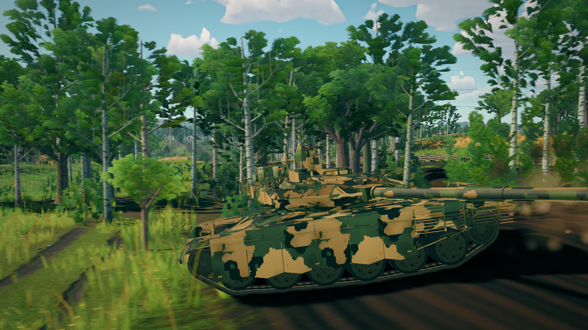</a><br><sub><b>T-90SM wedge:</b> A T-90SM wedge assaults through the burning fields.</sub></td>
<td width="50%"><a href="public/media/site50-r14/loops/s20-road-return-fire.webm">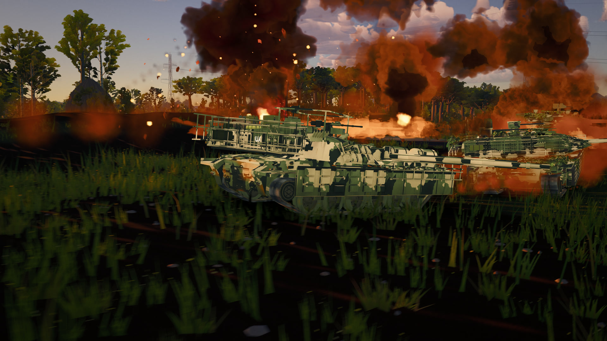</a><br><sub><b>Challenger 2 returning fire:</b> A Challenger 2 leads a column returning fire across the fields at sunset.</sub></td>
</tr>
<tr>
<td width="50%"><a href="public/media/site50-r14/loops/s226-church-duel.webm">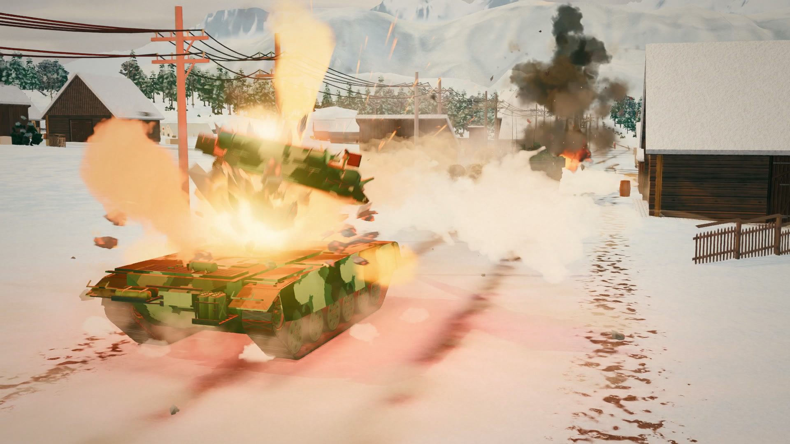</a><br><sub><b>Snowy village duel:</b> A Challenger 3 Prototype and a T-80U trade rounds down a snowy village street.</sub></td>
<td width="50%"><a href="public/media/site50-r14/loops/s26-minaret-fire.webm">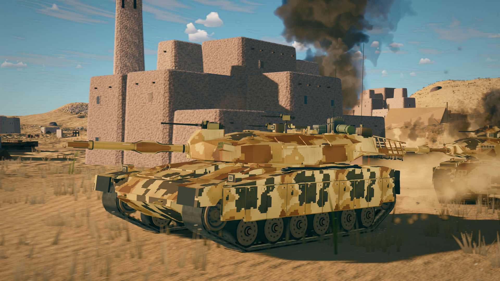</a><br><sub><b>Merkava Mk 3D fires:</b> A Merkava Mk 3D fires at Sunscar Oasis.</sub></td>
</tr>
</table>

<table>
<tr>
<td width="25%">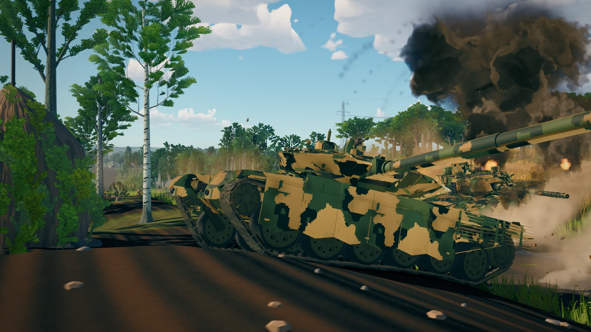</td>
<td width="25%">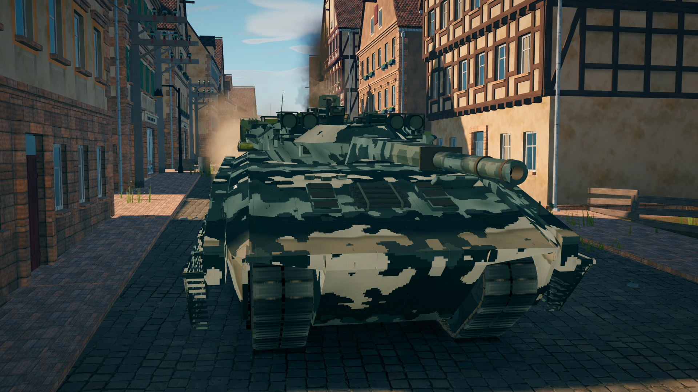</td>
<td width="25%">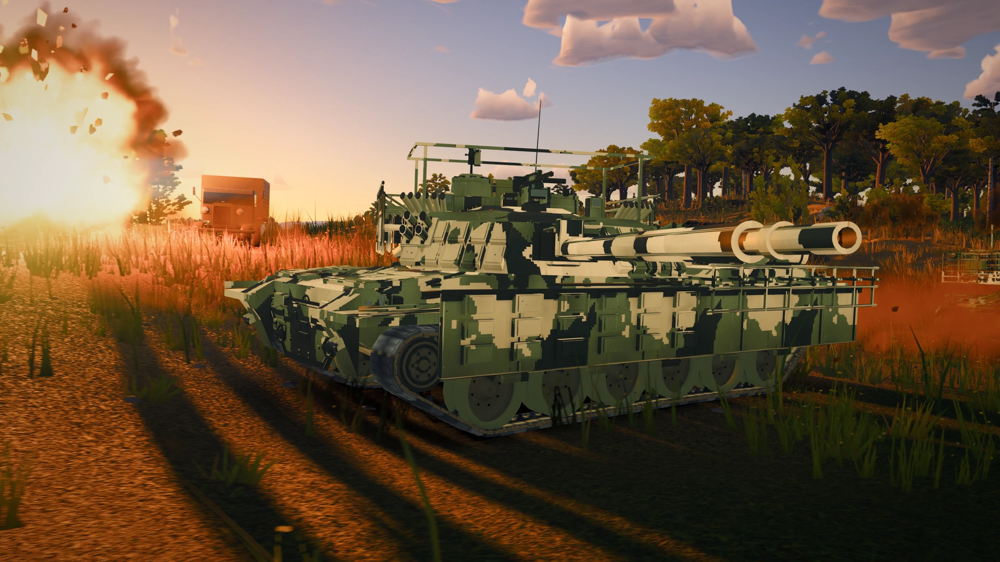</td>
<td width="25%">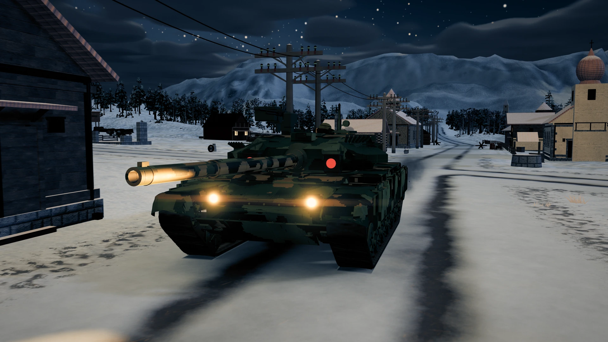</td>
</tr>
</table>

<p align="center">
  <a href="https://cot.kevinliu.studio/home"><strong>OPEN THE FULL LANDING SHOWCASE</strong></a>
</p>

## Vehicle-specific mechanics

<p>
  
  
  
</p>

Vehicles do not share one gun and one movement model. A specification can add its own loading, guidance, suspension,
ammunition, anatomy, and controls, and all of it still runs inside the fixed-step authority. Battle, Garage, Gallery,
Studio, bots, icons, diagrams, and technical dossiers all read the same 311 vehicle specifications.

- **Swedish siege suspension:** the Strv 103A, Strv 103B, and UDES 03 aim their fixed guns by pitching the physical hull.
  Wheels and both loaded track runs reshape around the solved pose.
- **Guided weapons:** the MBT-70 fires the Shillelagh as its primary round. IFVs carry vehicle-specific TOW, MILAN, Spike,
  Konkurs, Arkan, and Jyu-MAT launchers.
- **Magazine autoloaders** track ready rounds, cycle time inside the magazine, full replenishment, manual magazine
  reloads, shell changes, and damage to the loading mechanism. The Leclerc, Type 90, PL-01, and four-round PL-01 105 each
  carry their own magazine timings.
- **Guided missiles** fly at visible weapon-specific speeds and steer toward the authority's aim point. Launcher damage,
  rack damage, ammunition count, reload state, guidance, and impact stay in sync.
- **Air-defense vehicles** fire rotary and twin cannons at high rates from deep magazines, and some add missile racks that
  launch in salvos.
- **Hydropneumatic aim** uses one pose for armor, muzzle, collision, wheels, tracks, remote snapshots, and the camera.
  There is no separate visual-only tilt.
- **Free look** keeps the sight and turret on target while the camera moves. Hold `Caps Lock` or `Left Alt` on keyboard,
  `RB` on a standard controller, or assign another binding in settings.

## Combat systems

<p>
  
  
  
</p>

<table>
<tr>
<td width="50%">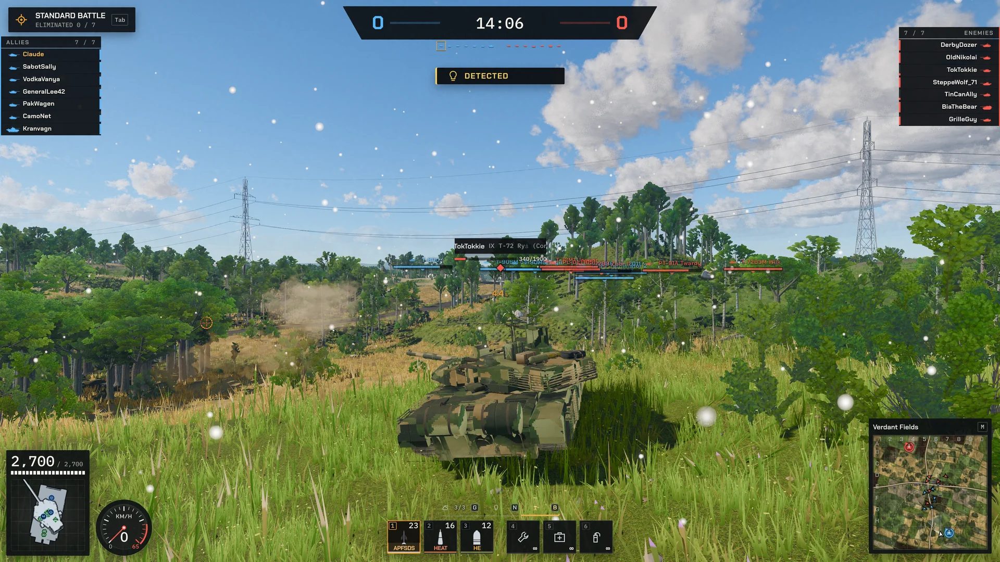<br><sub><b>Battle HUD:</b> dual reticle, ammunition, modules, teams, minimap, chat, performance, and authority-owned combat feedback.</sub></td>
<td width="50%">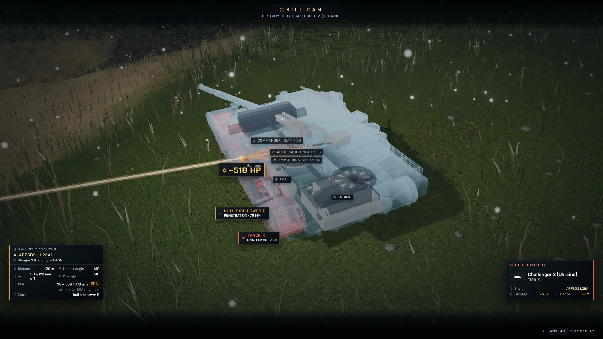<br><sub><b>X-ray killcam:</b> the resolved shell path, struck plate, effective protection, penetration result, damaged modules, and crew.</sub></td>
</tr>
<tr>
<td width="50%">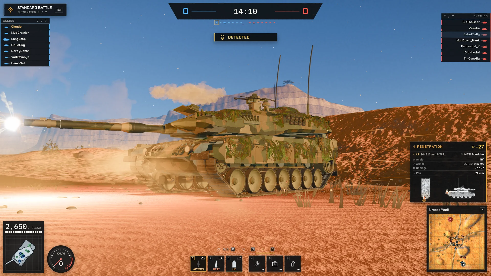<br><sub><b>Physical gunnery:</b> finite world aim, bore convergence, resolved muzzle transform, visible recoil, dispersion, travel time, and gravity.</sub></td>
<td width="50%">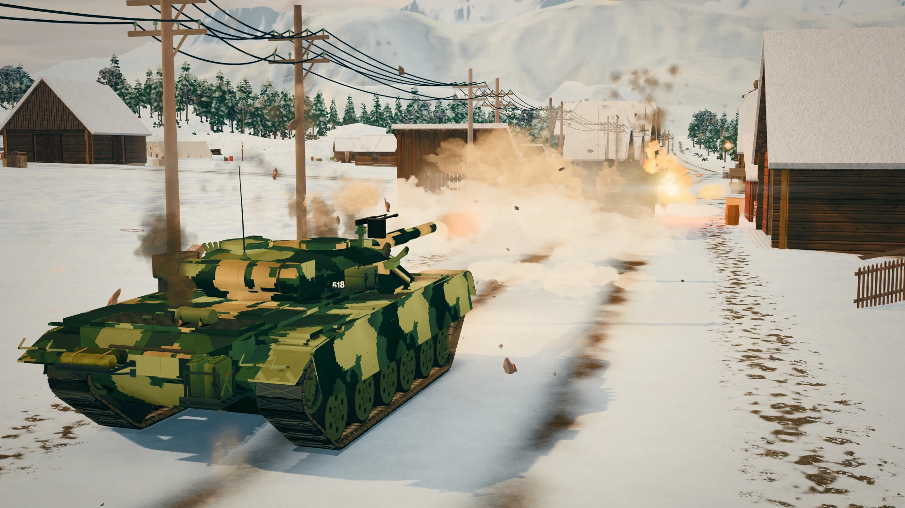<br><sub><b>Destruction:</b> fire, sparks, smoke, detached remnants, persistent wreck state, and pooled effects driven by the completed hit.</sub></td>
</tr>
</table>

- **Plate-level armor** resolves the actual plate, slope, impact angle, normalization, ricochet, overmatch, spaced armor,
  composites, ERA, and separate kinetic and chemical protection.
- **Five ammunition families** (AP, APCR, APFSDS, HEAT, HE) model muzzle velocity, gravity, penetration loss, ricochet,
  and damage differently.
- **Internal anatomy** tracks crew, ammunition racks, engine, fuel, gun, turret ring, optics, radio, and tracks.
- **Tank-specific mobility** combines drivetrain, terrain resistance, per-wheel support, suspension-damped hull attitude,
  flexible terrain-following tracks, collision, ramming, and crushable cover.
- **Spotting** combines view range, concealment, movement and firing bloom, foliage, radio sharing, and the 15 m bush
  rule. In multiplayer the authority drops hidden enemies before it serializes a snapshot.

## Worlds and vehicle design

<p>
  
  
  
</p>

<table>
<tr>
<td width="50%">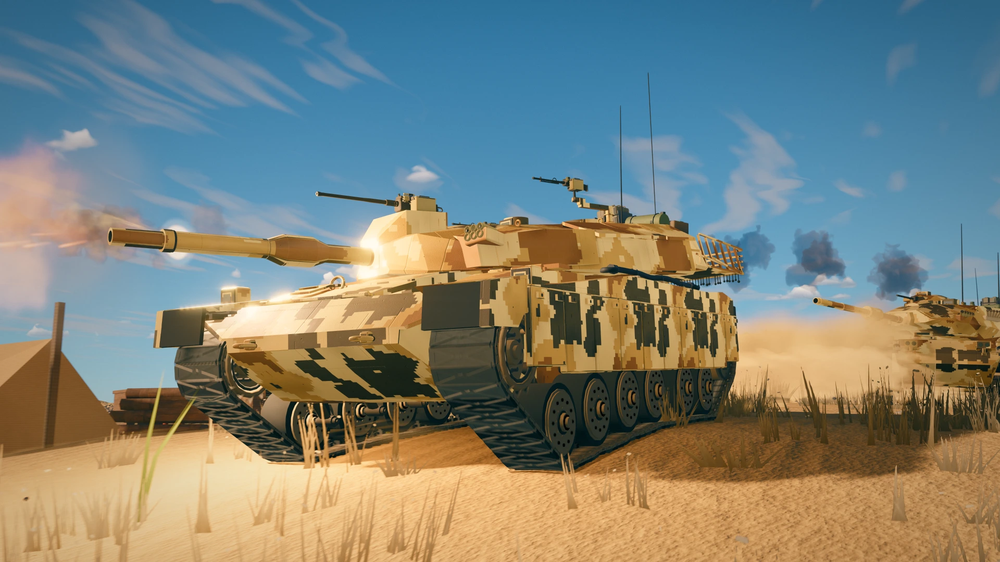<br><sub><b>Thirty-three worlds:</b> terrain, roads, structures, foliage, fog, sky, lighting, cover, collision, minimap, and dedicated-server descriptors.</sub></td>
<td width="50%">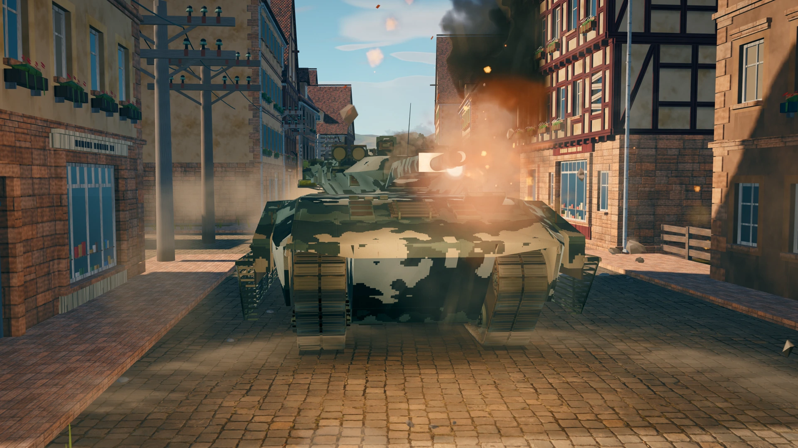<br><sub><b>Shared world kit:</b> destructible buildings, camps, wreck families, debris, utility lines, loose physical props, and narrow hitboxes.</sub></td>
</tr>
<tr>
<td width="50%">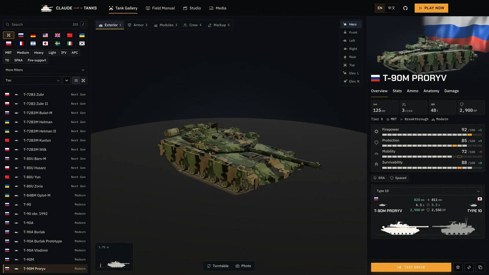<br><sub><b>Tank Gallery:</b> search all 311 vehicles, orbit and articulate the current rig, inspect armor, modules, and crew, and export exact-surface review packets.</sub></td>
<td width="50%">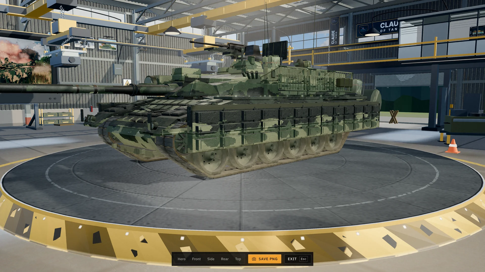<br><sub><b>Shared vehicle specification:</b> geometry, armor, modules, gun limits, ammunition, mobility, garage cards, bots, icons, diagrams, Gallery, and Studio.</sub></td>
</tr>
</table>

The repository's own vehicle pipeline builds every playable hull, turret, gun, fitting, suspension, road wheel, and track
run. A vehicle change passes combat-anatomy receipts, generated technical diagrams, geometry checks, visual
fingerprints, and a targeted release gate.

### Ten Garage environments

Verdant keeps the enclosed Motor Pool. The other nine locations are light scene packs drawn from a real battlefield's
terrain, structures, materials, trees, horizon, sky, and atmosphere, without loading that battlefield. One hero pose keeps
the tank and camera comparable across all ten. The [Garage environments guide](docs/GARAGE-ENVIRONMENTS.md) has the
visual, lifecycle, and verification contract.

## Renderer, drivers, and performance

<p>
  
</p>

The renderer treats quality as a per-device contract. It picks a profile for the GPU and driver, caps pixel density,
prewarms shader paths, scales costly effects, and recovers from a black frame or a lost WebGL context. The current path
combines:

- four quality-scaled, texel-anchored shadow cascades with articulation-aware tank shadow hulls;
- fused output grading, anti-aliasing, adaptive render scale, fog and atmosphere, and bounded transparent depth work;
- instanced and batched repeated world objects, pooled particles, and explicit GPU resource disposal;
- reused hot-loop scratch state, fixed-step simulation, render interpolation, and high-refresh presentation;
- an in-game diagnostics panel (`F9`) for FPS, ping, frame timing, draw calls, triangles, memory, network telemetry,
  quality, and renderer and driver identity.

The renderer reached **120 FPS on the certified test hardware**. Real performance depends on refresh rate, browser,
thermal limits, GPU and driver, resolution, and quality level. Combat rules stay at 60 Hz at every render rate.

## Multiplayer and couch play

<p>
  
</p>

Private and LAN rooms run the match in the host commander's browser over WebRTC, on the same renderer-free movement and
combat rules as solo play. There is no database and no dedicated game server. Internet rooms meet through a small rooms
Worker (seats, signaling, host migration), and restricted networks may need a TURN relay. A room holds up to 14 players a
side plus eight spectators. See [Multiplayer v2](docs/MULTIPLAYER-V2.md).

Clients send intent, never hits or damage. Snapshot filtering, local prediction and reconciliation, bounded remote
interpolation, reliable fire edges, reconnectable room state, and separate control and chat channels keep a battle
responsive without giving the client authority.

Couch play is a local battle on one computer. Phones join by QR code and send input over WebRTC; they never run the
simulation. Each pane in Split view draws only the enemies its own player has spotted. See
[Couch mode](docs/COUCH-MODE.md) and the [phone controller](docs/PHONE-CONTROLLER.md).

<p align="center">
  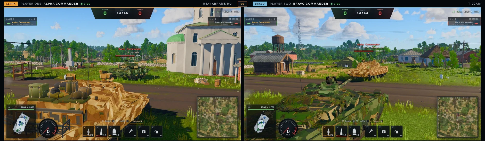
</p>

### Controls at a glance

| Action | Keyboard and mouse | Standard controller |
| --- | --- | --- |
| Drive and steer | `WASD` or arrow keys | Left stick |
| Aim and fire | Mouse + `LMB` | Right stick + `RT` |
| Precision sight | Hold `RMB` or press `Shift`; wheel in also enters | `LT` |
| Free look without moving the turret | Hold `Caps Lock` or `Left Alt` | `RB` |
| Select ammunition | `1` / `2` / `3` | D-pad up / left / right |
| Vehicle-specific action | `E` | `LB` |
| Reload a partial magazine | `C` | D-pad down |
| Consumables | `4` / `5` / `6` | `X` / `Y` / `B` |
| Air Support strike view | `X` | Remappable |
| Handbrake | `Space` | `A` |
| Shot log / battle diagnostics / menu | `L` / `F9` / `Esc` | `START` opens the menu |

Every desktop action is remappable. `RMB` can hold to aim, toggle aim, or act as classic free look. Touch devices get
their own movement, aim, scope, fire, ammunition, equipment, and special-action controls instead of a scaled desktop HUD.

## Production tools

<p>
  
  
  
</p>

<p align="center">
  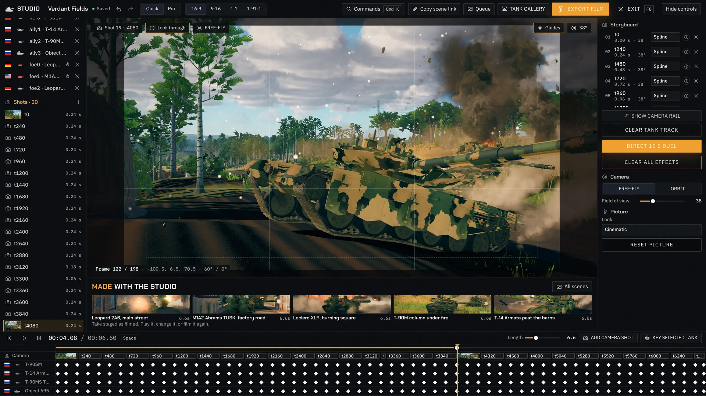
</p>

Scene Studio places any roster vehicle on any map, conforms it to terrain, poses it within physical limits, and
schedules game effects on a deterministic timeline. It drives the game's own renderer. Vehicles, camouflage, camera, lighting, recoil, tracers, explosions,
sparks, smoke, debris, wreck state, and timeline events are all scene data. A saved scene can be replayed, scrubbed,
edited, exported as JSON, captured as a high-resolution still, or recorded as video.

[docs/SHOWCASE-LIBRARY.md](docs/SHOWCASE-LIBRARY.md) records the public media library and how it is built and reviewed.
The [tank-generation handbook](docs/tank-generation/README.md) covers how a vehicle is built: measured geometry, Gallery
markup review, independent review gates, agent briefs, and handoff templates.

[Browse the full archive](public/media/site50-r14/archive.json),
[open the public Tank Gallery](https://cot.kevinliu.studio/gallery), or
[build a new shot in Scene Studio](https://cot.kevinliu.studio/studio).

## Architecture

```text
controls ──► deterministic authority ──► filtered state + reliable events ──► presentation
                 │                                                           │
                 ├─ movement / terrain / collision                            ├─ procedural vehicles
                 ├─ aim / ballistics / armor / anatomy                        ├─ tracks / suspension / FX
                 ├─ spotting / concealment / bots                             ├─ HUD / audio / killcam
                 └─ destructibles / match result                              └─ Three.js / post / Studio
```

```text
src/engine/    renderer, camera, lighting, post, quality, telemetry, GPU recovery
src/world/     thirty-three maps, terrain, vegetation, props, collision, destruction
src/vehicles/  specs, procedural geometry, materials, profiles, asset verification
src/sim/       DOM-free movement, aiming, ballistics, armor, damage, spotting, modes, Air Support
src/game/      local composition, bots, input, profile, killcam, Watch, Scene Studio
src/mp/        rooms, the wire, transports, the match client, the browser host, sessions
src/pad/       the phone controller and the couch lobby
src/ui/        garage, battle HUD, reports, Service Record, settings, the component kit, tokens, type
src/presentation/  the public site's shell, landing, media player and the /cn build
src/docs/      the Field Manual: chapters built from the game's own tables, prerendered
src/gallery/   Tank Gallery
server/        the match actor, the LAN room helper, collision manifests, ICE, telemetry
```

Start with [Technical overview](docs/TECHNICAL-OVERVIEW.md), [Product features](docs/FEATURES.md),
[How it works](docs/HOW-IT-WORKS.md), [Game modes](docs/GAME-MODES.md), [Multiplayer v2](docs/MULTIPLAYER-V2.md),
[Performance](docs/PERFORMANCE.md), [Scene Studio](docs/STUDIO.md), and [Tank Gallery](docs/GALLERY.md).

## Develop and verify

```bash
npm install
npx vite
npm test
npm run test:net:v2:p2p
npm run tank:native:check
npm run build
npm run build:private
```

The public pages carry generated parts. After a change to a chapter, the landing, the shell, or the tokens, rewrite them
(each checks without `--write`):

```bash
node tools/docs-prerender.mjs --write
node tools/home-premiere.mjs --write
node tools/public-shell.mjs --write
node tools/gen-tokens.mjs
```

Simulation, networking, browser multiplayer, maps, collision, destruction, rendering policy, UI, mobile controls,
vehicle provenance, anatomy, generated assets, and both build variants have executable checks.

## Deploying

Production (`cot.kevinliu.studio`) is deployed **once per round, by hand**, never per commit. Git auto-deploys are
disabled in `vercel.json` for every branch, so a push never builds on Vercel. The release path is the prebuilt CLI deploy
in [`docs/DEPLOYS.md`](docs/DEPLOYS.md) (`vercel pull --yes --environment=production` → `vercel build --prod` →
`vercel deploy --prebuilt --prod`), run after the release gate is green. There is no CI deploy.

## Credits and licensing

**Kevin B. Liu** created, designed, and directed the project. Claude and Codex assisted with research, vehicle authoring,
simulation, networking, design, performance, quality assurance, documentation, and deployment. They are development
tools, not co-authors or copyright holders.

All gameplay code and every selectable procedural vehicle model are original first-party work by Kevin B. Liu. The
repository is MIT-licensed by default, with procedural vehicle and battlefield source, fleet and map data, generated game
assets, capture recipes, authored media, and first-party branding expressly excluded as proprietary Reserved Content.
Earlier public revisions remain available under the MIT terms under which they were released. See [`LICENSE`](LICENSE),
[`LICENSE-POLICY.md`](LICENSE-POLICY.md), [`NOTICE.md`](NOTICE.md), and [`docs/ATTRIBUTION.md`](docs/ATTRIBUTION.md)
before reusing any file.
