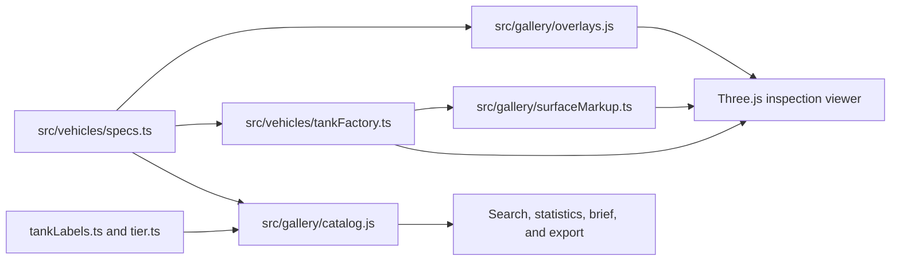

# Tank Gallery

Status: current public feature reference

Route: `/gallery`

Entry: `gallery.html`
Implementation: `src/gallery/`

The Tank Gallery is the public fleet reference for Claude of Tanks. It loads
the same first-party procedural vehicle constructor used by the garage, battle,
Scene Studio, and generated-asset tools, then presents one vehicle in a focused
inspection environment.

The Gallery does not maintain a separate vehicle registry. All labels,
specifications, armor plates, modules, crew volumes, and visual rigs come from
the canonical `src/vehicles/` sources.

## User capabilities

- search by vehicle name, stable ID, alias, nation, role, era, or tier;
- filter by nation and era;
- orbit, zoom, and select hero/front/left/right/rear/top/elevated cameras;
- enable or pause an automatic turntable;
- change hull yaw, turret yaw, and gun elevation within authored limits;
- display exterior, armor, module, crew, or exact-surface markup layers;
- read the armor as an absolute-millimetre heat map (kinetic, chemical or
  nominal values), with ERA, spaced and external layers in their own colours;
- open the X-ray: module models, P50 crew mannequins, exact hit volumes and
  the exterior as a glass shell, each behind its own toggle;
- select any plate, module or crew member, in 3D or through its badge, to read
  its identifier, ownership, dimensions and protection values;
- select a single triangle or connected coplanar patch from live geometry;
- record inspect, remove, reshape, or add-here instructions with articulation
  ownership, rig path, local/world bounds, centroids, normals, and pose;
- focus, undo, clear, copy, or download surface annotations and save a matching
  PNG review image;
- read normalized operational ratings and a generated technical brief for
  every playable vehicle;
- inspect dimensions, mobility, weapon, protection, and ammunition data;
- detonate individual ERA clusters, remove bound armor accessories, and repair them;
- damage or disable modules and crew, break tracks, and preview an ammo-rack wreck;
- toggle exact combat hitboxes, probe a shot line, reset the specimen, and copy its damage report;
- copy a shareable vehicle/layer URL;
- copy a versioned normalized data record;
- open the shared 88-frame field archive to inspect the same procedural rigs
  in combat, destruction, terrain, HUD, mobile, Gallery, and Studio contexts.

## Architecture



### Catalog

`catalog.js` converts each canonical specification into a read-only gallery
record. It owns:

- search text and filters;
- normalized 0–100 presentation ratings;
- derived metrics such as power-to-weight ratio and damage per minute;
- technical summary paragraphs and highlight bullets;
- the normalized copy-data schema.

Ratings are comparative presentation aids. Canonical raw values remain visible
in the dossier and in copied data.

### Viewer

`gallery.ts` owns the renderer, camera, lighting, environment, roster
interaction, selected vehicle, articulation controls, URL state, and browser
automation contract. It constructs vehicles with:

```js
createTank(id, engineCtx, {
  camoSeed: 4242,
  quality: 'high',
  proceduralOnly: true,
});
```

The viewer constructs a single vehicle at a time. Selecting another vehicle
removes and disposes the previous model before constructing the replacement.

The viewer header also opens the shared presentation archive. Gallery mounts
`src/presentation/mediaArchive.ts` only when the dialog is requested; the
component fetches `public/media/site50-r14/archive.json` (the site fifty's
frames and stills), lazy-loads its WebP previews in a horizontally scrollable compact rail, and reuses the same
lightbox/filter semantics as the landing page, field manual, and Studio. This
keeps the public route focused on the selected vehicle until the user opens the
larger archive.

### In action

The dossier's "In action" block shows the selected vehicle's own take: one
silent 6.6 s loop per production vehicle, indexed by spec id in
`public/media/site50-r14/fleet/index.json` (the media lane's data contract,
read by `src/ui/fleetTakes.ts`). `src/gallery/inAction.ts` and the index load
through `import()` once the first tank is on screen, so the Gallery's first
load and boot catalog are unchanged. The block stays hidden for a vehicle the
index lacks (or while the index is missing), shows the poster first, plays the
muted loop only while the block is visible (reduced motion and data saving
wait for the play control), and stops the moment the vehicle changes. Its link
opens the take's scene in the Studio as a preset (`/studio?scene=`). The Garage's
battle gallery, the manual's fleet reference and the Studio Director reach the
same takes; `src/gallery/inAction.selftest.mjs` and `src/ui/fleetTakes.selftest.mjs`
hold the contract.

### Anatomy layers

The Armor, Modules and Crew layers draw the vehicle's combat armor model as
real geometry. `anatomyView.ts` loads through `import()` the first time one of
them opens, so the Gallery's first load and the game's boot graph do not carry
it; the scene is built once per vehicle and specimen state and kept while the
layers switch.

| Layer | Canonical source | Presentation |
| --- | --- | --- |
| Exterior | Procedural vehicle rig | Current materials and geometry |
| Armor | `armor.collisionShells`, `hullPlates`/`turretPlates`, `externalWeapons`, `gunBarrel` | Opaque heat map on the absolute ramp (KE, CE or nominal mm); ERA, spaced, external and launcher layers translucent in identity colours; exterior as a faint glass shell |
| Modules | `armor.modules` (parts and hit shapes), the gun calibre, the era | X-ray: one model per combat module part inside that part's hit-shape bounds, crew mannequins, optional exact hit volumes |
| Crew | `armor.crew` (station boxes and hit shapes) | P50 (1.75 m) mannequins, head pinned on the combat head shape, posed by role; optional modules and hit volumes |

What is drawn is what the simulation tests:

- **Armor** mirrors `traceTank`'s plate selection (`anatomyData.armorSurfaces`).
  A frame with collision cells draws each cell as the intersection of its face
  planes, the surfaces `traceTank` actually enters, rather than the cell's
  triangle list (a few cells' triangles sit centimetres outside their own
  planes); every plated face is drawn, the slab-boundary `internal` hint
  included. Plates draw the test polygon of their own ray test in that test's
  plane. Surfaces are one-sided like the sim. Main armor takes the ramp; the
  ramp's lightness rises at every stop, so its order survives colour-vision
  loss.
- **Modules** are fitted, never moved: each model is built in its part's
  hit-shape bounds and scaled down per axis until it sits inside them. The
  form name, calibre and era choose the model; no model shows a part count,
  round count or capacity the data does not hold (a launcher whose form names
  its tube count draws that count, shared across its parts). Tracks are left
  to the exterior shell and the hit volumes.
- **Crew** mannequins are never scaled to their station. The head centre sits
  on the station's combat head shape; the pose comes from the role, tucked
  (trunk reclined, hips and knees flexed) until the boots clear the floor (the
  exact hull-shell floor, or the top of a stowage or powerplant module under
  the station) and the knees, ankles and toes stay inside the hull shell.
  Where no tuck keeps the legs inside, the figure slides along its station,
  head still inside the combat station box. A station too small for a person
  stays visible as one: the figure is not shrunk. Each figure is tinted by its
  role, with the role's colour on the helmet band.
- **Hit volumes** draw every module, crew and barrel hit shape exactly.

`src/gallery/anatomyFidelity.selftest.mjs` holds this for every vehicle:
rays from around each vehicle meet the drawn armor where `traceTank` strikes
its first plate, on the same plate; every main-armor triangle carries its
plate's ramp colour; module models sit inside their hit shapes in their combat
frames; every mannequin's head is on its head shape; every hit volume spans
its shape; and building the scene leaves the armor model byte-identical.

The legacy `overlays.ts` builders still render the baked side diagrams
(`tools/icons-page.html`) and the field-guide scenes; the Gallery no longer
imports them.

### Damage workbench

The damage workbench operates on the loaded specimen only. It never changes the
fleet registry, battle state, or saved progression. Loading another vehicle starts
intact. ERA and removable equipment are offered only when the procedural model
publishes a matching destruction binding; removal changes the real geometry and
removes that named plate from the specimen's diagnostic query. Repairing one
cluster preserves damage to the others.

Module damage uses the battle module state and weapon damage visuals. Broken
tracks advance the real running-gear simulation against the Gallery floor. Crew
stations can be disabled and restored. Ammo-rack wreck previews use the existing
destruction presentation; diagnostic layers and articulation are disabled until
reset because the detached wreck is no longer an intact combat specimen.

**Combat hitboxes** turns on the X-ray's Hit volumes: the canonical
ellipsoids, capsules, cylinders and barrel the sim tests, in the combat turret
and trunnion frames independently of presentation-only rig scaling. Damaged
and disabled modules and crew take a yellow or red tint on their models.

**Ray probe** traces a click through the current articulated specimen and reports
ordered geometry contacts, plate thickness, and incidence angle. Dragging still
orbits. This is a geometry inspection tool, not a shell penetration probability or
damage-roll simulator. Removed plates no longer appear in its contacts. **Copy
damage report** exports the vehicle, pose, selected part, and specimen condition.

Implementation: `damageLab.ts` owns isolated combat state, `damageWorkbench.ts`
owns controls, `combatHitboxes.ts` owns exact shape/frame presentation, and
`damageBurst.ts` owns a bounded, reusable ERA detonation effect. Transient state,
overlays, and ground callbacks are cleared when replacing the vehicle.

### Surface markup

`surfaceMarkup.ts` owns the geometry-review layer that previously lived in a
separate tool. It raycasts the currently visible first-party procedural rig,
groups connected triangles by an adjustable coplanarity threshold, parents
colored highlights to the selected mesh, and records the exact selection as a
portable review packet.

The Markup layer supports:

- `Inspect`, `Remove`, `Reshape`, and `Add here` operations;
- single-triangle and connected coplanar-patch scopes;
- Shift-click additive selection;
- freeform instructions, reshape offsets, and proposed primitive dimensions;
- selection focus, per-selection deletion, undo, and clear;
- JSON clipboard/download and PNG capture.

Highlights remain children of the selected mesh. Turret-, gun-, and
recoil-owned annotations therefore remain aligned while articulation controls
move the rig. Markup describes requested source changes; it never mutates the
runtime vehicle geometry.

## URL state

The Gallery uses query parameters so a record can be shared or restored:

```text
/gallery?id=m1a2
/gallery?id=t90m&layer=armor
/gallery?id=t90m&layer=markup
```

Supported `layer` values are `appearance`, `armor`, `modules`, `crew`, and
`markup`. `appearance` is omitted from the canonical URL. In the Armor layer,
`metric=ce` or `metric=physical` selects the chemical or nominal value
(`ke`, the default, is omitted). The retired
`/surface-studio` path redirects to `/gallery?layer=markup` so existing review
links remain useful.

## Copy-data schema

Copy data emits `claude-of-tanks/gallery-spec@1`:

```json
{
  "schema": "claude-of-tanks/gallery-spec@1",
  "id": "m1a1_abrams_hc",
  "name": "M1A2 Abrams",
  "authorship": {
    "creator": "Kevin B. Liu",
    "copyright": "Copyright © 2026 Kevin B. Liu",
    "license": "LicenseRef-Claude-of-Tanks-Proprietary-Content-1.0",
    "geometry": "first-party-procedural",
    "runtimeExternalGeometry": false
  },
  "nation": "USA",
  "era": "Modern",
  "class": "Main battle tank",
  "tier": 10,
  "dimensionsM": {},
  "mobility": {},
  "gun": { "shells": [] },
  "protection": {}
}
```

The record intentionally excludes Three.js objects, mutable match state,
functions, materials, and non-portable runtime identifiers.

## Surface-markup schema

Copy JSON and Download in the Markup layer emit schema version 1 with tool
identifier `tank-gallery-surface-markup`. Each packet includes:

- named Kevin B. Liu creator, copyright, license, and first-party/procedural
  authorship constraints;
- vehicle, camera, hull, turret, and gun pose;
- right-handed metre-based coordinate-system metadata;
- operation, scope, instruction, and optional offset or primitive request;
- mesh/material identity, rig path, instance identity, and triangle counts;
- exact face indices, bounds, centroid, anchor, normal, and representative
  triangle coordinates in local and world space.

The packet is an authoring reference, not a live edit command. Consumers must
review and implement the requested source change explicitly.

## Browser automation contract

The page exposes a small inspection API for verification:

```js
window.__TANK_GALLERY.ready
window.__TANK_GALLERY.count
await window.__TANK_GALLERY.loadTank('m1a1_abrams_hc')
window.__TANK_GALLERY.setMode('armor')
window.__TANK_GALLERY.frameView('front')
window.__TANK_GALLERY.setMode('markup')
window.__TANK_GALLERY.setMarkupOperation('reshape')
window.__TANK_GALLERY.selectSurface(640, 420, false)
window.__TANK_GALLERY.exportMarkupJSON()
window.__TANK_GALLERY.damageAction('disable', 'module:trackL')
window.__TANK_GALLERY.resetDamage()
window.__TANK_GALLERY.getState()
```

`getState()` returns selected ID, active mode, overlay count, camera pose, and
serializable markup and damage-state snapshots. It does not expose the mutable Three.js
scene.

## Keyboard and accessibility

- `/` focuses archive search;
- `1` selects the exterior layer;
- `2` selects armor;
- `3` selects modules;
- `4` selects crew;
- `5` selects surface markup;
- `Shift+1` through `Shift+4` select inspect, remove, reshape, or add while
  markup is active;
- `Cmd/Ctrl+Z` undoes the last surface annotation;
- `Delete` removes the selected surface annotation;
- all controls use native buttons, inputs, selects, labels, and visible focus;
- roster selection is exposed as a listbox with selected-option state;
- loading, copy, and mode changes use status announcements;
- reduced-motion preferences disable nonessential animation.

## Performance boundaries

- The Gallery is a separate Vite entry and does not enter the playable boot
  graph from `/home` or `/docs`.
- It constructs one high-quality visual at a time.
- Diagnostic geometry exists only for the active layer and is explicitly
  disposed when the layer or vehicle changes.
- Surface highlights exist only for the selected vehicle and dispose when the
  selection or vehicle is cleared.
- The animation loop reuses control and renderer objects and performs no
  catalog derivation.
- Roster portraits load lazily.

## Verification

Run the focused self-tests first:

```bash
node src/gallery/catalog.selftest.mjs
node src/gallery/surfaceMarkup.selftest.mjs
```

They verify that every `ALL_TANK_IDS` entry receives a complete record, ratings
remain within bounds, stable IDs are searchable, filters are exact, the fleet
export schema is populated, coplanar grouping is bounded, and articulation
ownership resolves to the nearest rig owner.

Then run:

```bash
npm test
npm run build
```

For user-facing verification, open `/gallery`, select multiple vehicles, test
all five layers and camera presets, select at least one overlay volume, create
single and additive surface annotations, exercise undo/focus/export, copy a
link and data record, and repeat the layout at desktop and mobile widths.

## Damage-workbench verification

`src/gallery/damageLab.selftest.mjs` verifies isolated state, individual ERA
repair, real T-90M geometry removal/restoration, tracks, crew, and wreck reset.
`src/gallery/combatHitboxes.selftest.mjs` verifies exact primitive dimensions,
compound gaps, track prisms, and articulated frames with scaled presentation rigs.
Both are registered in the selftest suite. The existing overlay fleet audit also
covers every registered vehicle.

`tools/gallery-damage.browser.mjs` exercises the controls and viewport fitting
at desktop, phone portrait, and short phone landscape sizes. Run it through the
shared browser capture lease. The initial October 7 run timed out waiting for
that lease, so desktop/mobile visual verification remains outstanding.
